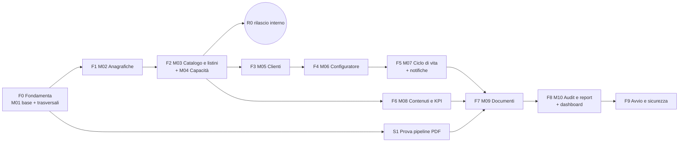

# Pianificazione e MVP (Fase 6) — Portale Commerciale Infront

Stato: **Fase 6 aperta (D-233)** · 6.1 approvato (D-234…D-239) · 6.2 approvato (D-243…D-247) · 6.3 approvato (D-249…D-254) · **6.4 in attesa di autorizzazione al codice** · ultimo aggiornamento 2026-10-21

Legenda: ✅ confermato · 💡 proposta · ❓ da chiarire · ⚠️ rischio

## Blocchi (D-233, sequenza D-240)
| Blocco | Contenuto | Stato |
|---|---|---|
| 6.1 | Perimetro MVP e ordine dei moduli | ✅ Approvato (D-234…D-239) |
| 6.2 | Stime e milestone, data di avvio, uso del vecchio sistema dopo l'avvio | ✅ Approvato (D-243…D-247) |
| 6.3 | Preparazione del repository (`CLAUDE.md`, `docs/`, CI, verifica layout D-226) | ✅ Approvato (D-249…D-254) |
| 6.4 | Avvio dello sviluppo dalla fetta F0 — **solo con autorizzazione esplicita al codice** | In attesa di autorizzazione |

---

## 6.1 Perimetro MVP e ordine dei moduli (✅ D-234…D-239)

### 6.1.1 Vincoli di partenza
| Vincolo | Origine | Conseguenza sulla pianificazione |
|---|---|---|
| Avvio con la stagione 2027-28, nessuna migrazione, disponibilità da zero | ✅ D-227 | Al primo giorno **nel portale non esiste una stagione precedente** |
| Passaggio netto, nessun uso in parallelo | ✅ D-146 | Al go-live servono tutte le funzioni del ciclo commerciale, **documento PDF compreso** |
| Dati di avvio inseriti da Antonio | ✅ D-231 | Mole di dati importante: distribuita nel tempo con il rilascio interno R0 (D-235) |
| Vendite 2027-28 prima della pubblicazione dei calendari; apertura vendite a giugno 2027 | M02 RB-05, D-187, ✅ D-242 | Numero standard di partite dal primo giorno; go-live prima di giugno 2027 |
| Verifica dei layout dinamici sui PDF/PPTX di esempio | ✅ D-226, D-232 | Si svolge in 6.3, prima della fetta S1 |
| Sviluppo di Claude con revisione di Antonio, una PR per funzione con test | ✅ D-168, D-170 | Fette verticali piccole; i criteri di accettazione numerati diventano test |

### 6.1.2 Perimetro del rilascio 1.0 (✅ D-234)
**Entra**: tutte le funzioni delle specifiche approvate **M01–M10** con le decisioni successive (D-187, D-197, D-203…D-222); gli **script di dati iniziali** dal dump (D-229); i **seeder dei dati di sistema** (A1, progettazione-tecnica §5.6.1); le **predisposizioni del modello** (D-062, D-122…D-124, D-132, D-212) rispettate nello schema, senza funzioni.

**Non entra**: **M11** (D-227); le evolutive **EV-01…EV-24**.

**Rilascio 1.1** (✅ D-236, D-237, D-246)
| Funzione | Spec | Motivo |
|---|---|---|
| Nuova stagione dalla precedente con copia delle iscrizioni | M02 F-04 | Al go-live non esiste una stagione precedente (D-227) |
| Copia del listino con +% | M03 F-12 | Idem; criterio M03-5 collaudato nel 1.1 |
| Copia delle capacità | M04 F-05 | Idem |
| Copia di slide, condizioni e KPI | M08 F-07 | Idem |
| API anagrafica `/api/v1` | M02 F-13, D-217 | Nessun consumatore al go-live; anticipata se la revisione degli accrediti parte prima. Modello già nel 1.0 |

⚠️ **Non rinviabile**: l'**audit** registra eventi dalla prima fetta che scrive dati (infrastruttura in F0); consultazione e report in F8.

### 6.1.3 Fette verticali e dipendenze (✅ D-234, D-239)

| # | Fetta | Contenuto | Dipende da | Criteri di accettazione coperti |
|---|---|---|---|---|
| **F0** | Fondamenta (M01 base + trasversali) | Scheletro applicativo, CI e deploy su staging (D-178; deploy rinviato a quando lo staging su server è pronto, D-261); login Fortify + 2FA obbligatoria, blocco tentativi, scadenze per ruolo, attivazione con token (D-214); gestione utenti dell'admin; Policy/Gate con **test di matrice** (D-215); infrastruttura **audit** append-only (D-210, D-211) con eventi di accesso; `stored_files` e upload ricodificati (D-218); `settings`; code Redis/Horizon, coda `mail`, `notification_logs`, Mailpit; struttura dell'interfaccia (menu per ruolo, selettore stagione, stati di ux §4.5); seeder A1; `/health` e monitoraggio errori. Elenco delle PR: `docs/dev/pr-f0.md` nel repository | — | M01: 1, 2, 3 (parziale), 5 · M10: 2, 3 |
| **S1** | Prova della pipeline PDF | Una slide statica e una dinamica con font Interstate, Chromium senza rete + qpdf **nella VM locale e in CI** (D-261): tempo, peso, resa; si ripete sullo staging quando disponibile. Il codice resta come base di F7 | F0; verifica D-226 (6.3) | Anticipa M09 CA 4 |
| **F1** | M02 Anagrafiche sportive | Discipline, stagioni, competizioni, edizioni, iscrizioni, club con alias, stadi, giornate, partite; import Excel con anteprima e alias; calcolo partite (F-12) con RB-05 (D-187) e top match; script dei club dal dump (D-229) | F0 | M02: 1–8 |
| **F2** | M03 Catalogo e listini + M04 Capacità | Catalogo; listino per stagione bozza/pubblicato a griglia; prezzi; testi on top e benefit facoltativi; capacità con flag "gestito"; vista disponibilità e servizio residui | F1 | M03: 1–4, 7, 9 · M04: 3, 4, 10 |
| **R0** | Rilascio interno (✅ D-235) | Produzione aperta al solo admin per caricare stagione 2027-28, club, stadi, iscrizioni, listino, capacità | F2 | — |
| **F3** | M05 Clienti | Settori, anagrafica con controllo duplicati (D-080, D-197), proprietà, assegnazione e unione, disattivazione; completa **M01-CA4** (riassegnazione dei clienti dell'agente disattivato, conteggio dei clienti nel dialogo "Disattiva utente", D-282) | F0 (F2 per il configuratore) | M05: 1–8 · M01: 4 |
| **F4** | M06 Configuratore | Percorso a 5 passi tablet-first, totale sempre visibile, residui, copia su altri club, duplica, riepilogo con KPI di campagna, salvataggio automatico | F1, F2, F3 | M06: 1–8, 10 · M03: 6, 8 · M04: 5, 7 |
| **F5** | M07 Ciclo di vita + notifiche | Invio, ritiro, coda, blocco di lavorazione, sconto, approvazione transazionale (D-216), forzatura, rifiuto e reinvio, versioni, annullamento, cronologia; e-mail di M01 §7 | F4 | M07: 1–8 · M04: 1, 2, 6, 8, 9 · M01: 4, 6 |
| **F6** | M08 Contenuti e KPI | Sezioni, libreria slide con condizioni, slide dinamiche, KPI, avvisi; simulatore | F2 | M08: 1–5, 7, 8 |
| **F7** | M09 Documenti | Composizione, 9 layout dinamici (`docs/layout-dinamici.md`), snapshot e `page_model`, pipeline, archivio, download, rigenerazione (D-205), e-mail dopo il documento (D-221) | F5, F6, S1 | M09: 1–7 · M08: 6 · M06: 9 |
| **F8** | M10 Audit e report + dashboard | Consultazione audit, cronologia completa, R-01…R-07, dashboard per ruolo | F5, F7 | M10: 1, 4–7 |
| **F9** | Avvio e sicurezza | Script utenti (D-229); revisione di sicurezza (§5.2.4); prova di ripristino; checklist di avvio (§5.6.4) | Tutte | Criteri residui |

### 6.1.4 Milestone di collaudo (✅ D-234, D-238)
| Milestone | Fette | Chi collauda | Cosa serve da Infront |
|---|---|---|---|
| **A · Dati di base** | F0, S1, F1, F2 | Antonio; per l'import calendario anche il gestore | Calendario Excel reale nel tracciato D-017; listino e capacità di 2–3 club come dati di prova; conferma licenza font (D-224) |
| **B · Ciclo commerciale** | F3, F4, F5 | 2–3 agenti pilota su tablet, 1 gestore, l'admin (D-238) | Scenari dai criteri di accettazione; account di staging con 2FA; mezza giornata per sessione |
| **C · Documenti** | F6, F7 | Gestore o marketing Infront, l'admin | Slide PNG 1920×1080 definitive di almeno 2 club e del network; KPI verificati (D-206); logo ufficiale Infront |
| **D · Pre-avvio** | F8, F9 | Infront (collaudo finale firmato) | Chiusura di D-180; elenco utenti definitivo |

---

## 6.2 Stime e milestone (✅ D-243…D-247)

### 6.2.1 Ipotesi di stima
- Le stime sono **settimane di calendario** per fetta, comprese scrittura del codice e dei test (Claude), revisione delle PR e correzioni. Il collo di bottiglia atteso è la **revisione e il collaudo di Antonio**, non la scrittura.
- ✅ Capacità di Antonio per revisione e collaudo: **8–10 ore a settimana** (D-244), da riconfermare al checkpoint.
- Pause considerate: Natale (24/12–6/1), Pasqua (28–29/3/2027), 25/4, 1/5.
- Il collaudo di una milestone procede **in parallelo** allo sviluppo della fetta successiva.

### 6.2.2 Calendario (✅ D-243)
| Periodo | Attività | Settimane | Esito |
|---|---|---|---|
| 20/10 – 30/10/2026 | **6.3** Preparazione del repository e verifica D-226 | 1,5 | `CLAUDE.md`, `docs/`, layout verificati |
| 2/11 – 18/11 | **F0** Fondamenta | 2,5 | ✅ Completata il 25/10/2026 (PR-00…PR-09) |
| 19/11 – 25/11 | **S1** Prova pipeline PDF | 1 | ✅ Completata il 25/10/2026 (D-308…D-314). Sulla VM con Interstate: deck di 40 slide, **10,5 MB** (M09-CA4 ≤ 15 MB), **12,3 s** (composizione 2,9 · Chromium 1,8 · qpdf 0,2 · controlli 7,4); recap network con la grafica dell'originale (D-314). Da ripetere sullo staging |
| 26/11 – 9/12 | **F1** M02 | 2 | |
| 10/12 – 23/12 | **F2** M03 + M04 | 2 | |
| 7/1 – 15/1/2027 | Collaudo **milestone A** (Antonio) | — | |
| entro 18/1 | **R0** rilascio interno in produzione | — | Antonio inizia a caricare i dati 2027-28 |
| 7/1 – 13/1 | **F3** M05 | 1 | |
| 14/1 – 3/2 | **F4** M06 | 3 | |
| 4/2 – 24/2 | **F5** M07 + notifiche | 3 | |
| 1/3 – 12/3 | Collaudo **milestone B** (agenti pilota, gestore) · **checkpoint di pianificazione** (D-247) | — | Verifica del margine sul go-live |
| 25/2 – 10/3 | **F6** M08 | 2 | |
| 11/3 – 13/4 | **F7** M09 (Pasqua compresa) | 4,5 | |
| 14/4 – 23/4 | Collaudo **milestone C** | — | |
| 14/4 – 23/4 | **F8** M10 + dashboard | 1,5 | |
| 26/4 – 7/5 | **F9** Avvio e sicurezza | 2 | Revisione di sicurezza, prova di ripristino |
| 10/5 – 14/5 | Collaudo finale **milestone D** | — | Firma di Infront |
| 17/5 – 21/5 | Finestra di preparazione: completamento dati, utenti, e-mail di attivazione | — | |
| **24/5/2027** | **Go-live** · vecchio sistema in sola lettura (D-245) | — | |
| giugno 2027 | Apertura vendite 2027-28 (D-242) | — | ❓ Giorno esatto da comunicare: il margine reale dipende da quello |

⚠️ **Margine ridotto**: circa 23 settimane di sviluppo su 27 disponibili.
✅ **Avanzamento al 25/10/2026**: F0 e S1 completate circa 4 settimane prima del calendario. Il calendario approvato (D-243) non cambia: l'anticipo resta margine sul go-live e si rivede al checkpoint del 12/3/2027.
✅ **Checkpoint al 12/3/2027** (D-247): se il ritardo supera 2 settimane si decide solo allora una delle leve:
- report R-01…R-05 e R-07 in un rilascio 1.0.1 entro 3 settimane dal go-live (l'audit registra comunque dal primo giorno; R-06 resta nel 1.0);
- spostamento del go-live, se l'apertura delle vendite lo consente.

### 6.2.3 Prerequisiti e scadenze esterne
| Entro | Chi | Cosa | Serve per | Stato |
|---|---|---|---|---|
| 23/10/2026 | Antonio | Nuovo repository GitHub privato (D-241) | 6.3 | ✅ `bitandsolution/infront-portale-commerciale` (D-248) |
| 27/10 | Antonio | Cartella con PDF/PPTX di esempio e font Interstate collegata alla chat | Verifica D-226 | ✅ Collegata il 21/10 |
| 30/10 | Antonio | **VM VirtualBox** locale con Docker e Sail (`docs/dev/ambiente-locale.md`) | Collaudo delle PR di F0 (D-261) | ✅ In uso dalla PR-00 |
| ~~13/11~~ → 26/2/2027 | Antonio | **Staging su server** conforme a R1–R7, utente di deploy (R6). Richiesta all'amministratore: VM dedicata con root oppure pacchetti (D-261) | Deploy automatico, milestone B con agenti pilota | |
| 13/11 | Infront | Conferma della licenza dei font per l'incorporamento nei PDF generati da server (D-224) — Regular, Bold e **Black** (D-249) | S1 | ✅ Confermata (D-256) |
| 30/11 | Infront | Calendario Excel reale nel tracciato D-017 | F1, milestone A | |
| 15/1/2027 | Antonio | **Produzione** conforme a R1–R7, backup fuori dall'host attivi | R0 (D-235) | |
| 31/1 | Infront | Nominativi di agenti pilota e gestore (D-238) | Milestone B | |
| 26/2 | Antonio / Infront | **Servizio e-mail** (D-180) | Attivazione dei gestori, collaudo C | |
| 10/3 | Infront | Slide PNG definitive (2 club + network), **sfondi standard di KPI club e digital club** (D-250), **logo ufficiale Infront**, KPI verificati | F7, milestone C | |
| 30/4 | Antonio / Infront | **Dominio e DNS**, requisiti **GDPR** ed eventuale penetration test (D-180); elenco utenti definitivo | F9, milestone D | |
| luglio 2027 | Antonio | Import dei calendari 2027-28 appena pubblicati | Fine dell'uso del numero standard | |

### 6.2.4 Vecchio sistema dopo l'avvio (✅ D-245)
Dal go-live il vecchio sistema passa in **sola lettura** (consultazione delle proposte 2026-27) e viene **spento entro il 30/6/2027**, dopo che Infront ha completato il proprio archivio (D-228). ⚠️ Il server è da considerare compromesso: più breve è il periodo in sola lettura, meglio è.

### 6.2.5 Rilascio 1.1 (✅ D-246)
Sviluppo tra settembre e novembre 2027, rilascio **entro il 31/1/2028**, così la stagione 2028-29 si prepara con le funzioni di copia (D-236). L'API (D-237) segue l'avvio della revisione degli accrediti, se anteriore.

---

## 6.3 Preparazione del repository (✅ D-249…D-254)

Repository: `github.com/bitandsolution/infront-portale-commerciale` (D-248). Contenuto pubblicato su `main` (primo commit di sola documentazione, D-254):

| File | Contenuto |
|---|---|
| `CLAUDE.md` | Regole per le sessioni di sviluppo: fonti di verità, stack, architettura e cartelle, convenzioni C1–C12, invarianti di dominio, sicurezza, **glossario IT→EN**, lingue, flusso di lavoro, test, comandi, **definizione di "fatto"**, cosa non fare |
| `docs/README.md` | Indice e regole di aggiornamento dei documenti |
| `docs/specs/spec-M01…M10` | Specifiche approvate con **note di allineamento**: D-197 recepita in M05; stati corretti in "approvata" (M04, M05, M06, M08); funzioni del rilascio 1.1 segnate (M02, M03, M04, M08); riferimenti alla migrazione segnati come non applicabili |
| `docs/specs/spec-M11-migrazione.md` | Segnata **non applicata** (D-227); resta il perimetro degli script di dati iniziali (D-229, D-230) |
| `docs/layout-dinamici.md` | **Esito della verifica D-226** sui PDF e PPTX di esempio: misure dei 9 layout, font, formati, colori, difetti attuali, capienze e slide di continuazione |
| `docs/dev/ci.md` | Pipeline CI e deploy (i workflow si scrivono con PR-00) |
| `docs/dev/pr-f0.md` | Le 10 PR della fetta F0 |
| `docs/registro-decisioni.md`, `pianificazione.md`, `progettazione-tecnica.md`, `ux-architettura.md`, `features-evolutive.md` | Copie dei documenti di progetto |

### 6.3.1 Esito della verifica dei layout (sintesi; dettaglio in `docs/layout-dinamici.md`)
- ✅ Struttura confermata: il vecchio sistema compone ogni pagina da uno sfondo JPEG 1920×1080 più testi e loghi. È lo stesso principio di D-116. Il peso osservato (circa 200 KB a pagina) conferma 5–15 MB per 40 slide.
- ✅ Interstate Regular, Bold e Black contengono €, accenti e punteggiatura italiana; l'incorporamento dichiarato ("anteprima e stampa") è compatibile con un PDF in sola lettura.
- ⚠️ I PDF attuali usano anche **Interstate Black** (non compreso in D-224) e **Calibri** per i prezzi.
- ⚠️ I documenti club hanno **grafiche diverse per club**: posizioni e colori fissi per layout non bastano per copertina, KPI club e digital club.
- ⚠️ I KPI del documento club oggi sono **dentro le immagini statiche**.
- ⚠️ **Top match**: il vecchio sistema conta solo gli ospiti con il flag (5 + 5 = 10 per Bologna + Como, come nel PDF), ma la nota del documento cita anche la Lazio, che nel database non ha il flag.
- Difetti attuali da non riprodurre: intestazioni delle tabelle illeggibili, prezzo barrato sovrapposto al totale, "Total / season" in inglese, numeri inseriti dentro frasi stampate sullo sfondo.

### 6.3.2 Decisioni (✅, risposte di Antonio alle domande del blocco)
1. **Font** (D-249, sostituisce D-224): Interstate Regular, Bold e Black, caricati da file; Calibri sostituito da Interstate. Licenza da confermare con Infront per i tre pesi entro il 13/11/2026.
2. **Grafiche per club** (D-250): colonna `slides.layout_options` (riquadro del logo, colori); il grafico Infront prepara per ogni club gli sfondi standard di KPI club e digital club entro il 10/3/2027.
3. **Ambito per competizione** (D-251): con condizione sulla competizione, i dati delle slide network considerano solo i club di quella competizione.
4. **Copertina** (D-252): logo del cliente e data di approvazione della versione, senza ragione sociale (corretti M08 §4.3 e M09 CA 3).
5. **Top match** (D-253): RB-06 invariata (ospite con il flag); la Lazio riceve il flag. Elenco da confermare con Infront prima del caricamento dei dati 2027-28.
