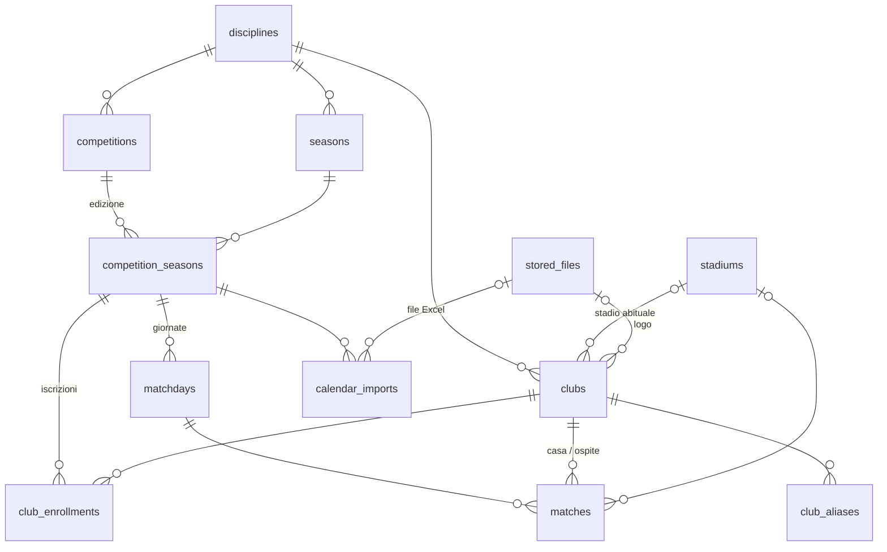
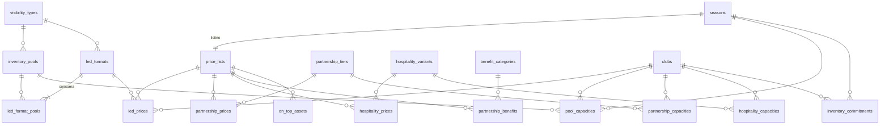
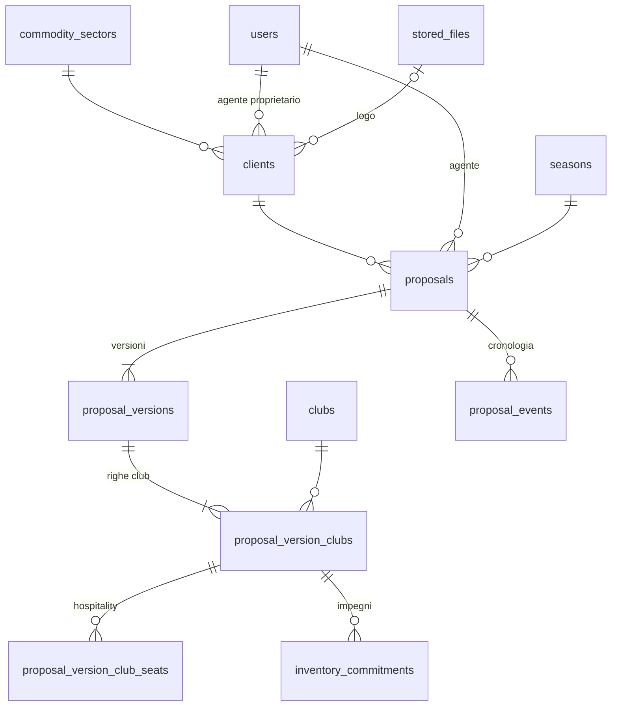
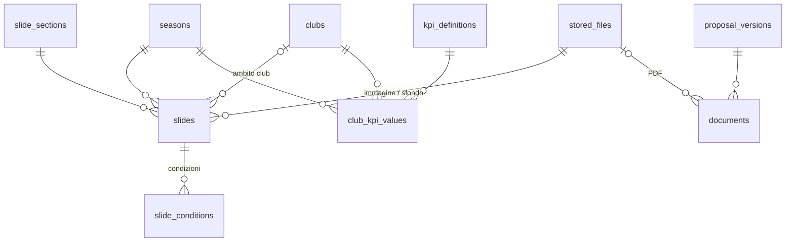

# Progettazione tecnica — Portale Commerciale Infront

Stato: **Fase 5 chiusa (D-232)** · ultimo aggiornamento 2026-10-16

> **Note di allineamento (repository, 2026-10-21)**
> - Il documento resta quello approvato in Fase 5. Le parti scritte come **proposte e domande** (💡, ❓) sono state approvate con le decisioni indicate nei paragrafi "Esito"; fa fede il registro.
> - Le parti su **migrazione** (`idoc__*`, `is_legacy`, stato "historical", §5.6.2–§5.6.3) restano come riferimento: **nessuna migrazione** (D-227). Restano gli script di dati iniziali (`docs/specs/spec-M11-migrazione.md`).
> - API anagrafica (§5.4.5): nel **rilascio 1.1** (D-237).
> - Font dei documenti: Interstate Regular, Bold e Black (D-249), esito della verifica in `docs/layout-dinamici.md` §2.1.
> - Tabella `slides` (§5.3.5): aggiunta la colonna JSON **`layout_options`** (riquadro del logo, colori), validata con valori predefiniti (D-250). Ambito dei dati per competizione D-251; copertina D-252; flag top match della Lazio D-253.

## Blocchi (D-167, approvata)
| Blocco | Contenuto | Stato |
|---|---|---|
| 5.1 | Stack e architettura applicativa | Approvato (D-169…D-173); versioni aggiornate da D-174 |
| 5.2 | Hosting, sicurezza, backup, deploy | Approvato (D-174…D-181) |
| 5.3 | Modello dati | ✅ Approvato (D-182…D-213); G6 sospeso con la migrazione (D-200) |
| 5.4 | API, autenticazione (2FA), permessi | ✅ Approvato (D-214…D-219) |
| 5.5 | Generazione documentale e code di lavoro | ✅ Approvato (D-220…D-226); verifica layout sui PDF di esempio da fare |
| 5.6 | Piano di avvio (al posto della migrazione, D-225) | ✅ Approvato (D-227…D-232) |

## 5.1 Stack e architettura

### Requisiti che pesano sulla scelta
| Requisito | Origine | Impatto tecnico |
|---|---|---|
| Anagrafica sportiva centralizzata, unico punto di scrittura, letta da altre piattaforme Infront (accrediti) | M02, D-035 | Serve un'API stabile e documentata; schema DB condiviso o servizio separato |
| PDF da slide PNG 1920×1080 + slide dinamiche su layout | M08, M09 | Motore di rendering HTML→PDF (Chromium headless) e post-elaborazione (JPEG q85, linearizzazione): richiede un server dove installare software, non un hosting condiviso |
| Generazione all'approvazione e a ogni versione | M09 | Coda di lavori in background con nuovi tentativi |
| 2FA obbligatoria, ruoli, audit 5 anni | M01, M10 | Libreria di autenticazione matura; log append-only |
| Magazzino con consumo all'approvazione e forzature | M04, M07 | Transazioni e lock sulle risorse per evitare doppi impegni concorrenti |
| Migrazione da MySQL `idoc__*` | M11 | Script di import una tantum |
| Tablet, bozza salvata automaticamente, offline solo come avviso | §4.5 | SPA o pagine reattive; nessuna sincronizzazione offline |
| Fino a 40 utenti, volumi bassi (centinaia di proposte/anno) | M01 | Nessuna esigenza di scalabilità: conta la manutenibilità |

### Opzioni
| | A · Laravel (PHP) | B · Node/TypeScript (Next.js) |
|---|---|---|
| Composizione | Laravel 11 + MySQL 8 + Inertia/Vue 3 (o Livewire) + Redis per le code | Next.js + Prisma + PostgreSQL + coda (BullMQ/Redis o pg-boss) |
| Auth, 2FA, ruoli | Fortify/Breeze con TOTP, Policy, Gate: pronti all'uso | Auth.js/Lucia + libreria TOTP: più assemblaggio |
| Code, scheduler, e-mail | Integrati nel framework | Librerie separate da integrare |
| PDF | Browsershot (Chromium) + Ghostscript/qpdf | Playwright/Puppeteer + qpdf |
| Continuità con l'esistente | Alta: il sistema attuale e (probabilmente) gli accrediti sono PHP/MySQL; migrazione MySQL→MySQL | Media: migrazione MySQL→PostgreSQL, nessun problema a questi volumi |
| Hosting | VPS con PHP-FPM + nginx o Docker | VPS con Node in Docker |
| Manutenibilità nel tempo | Ecosistema stabile, molti sviluppatori PHP in Italia | Ecosistema più veloce a cambiare (Next.js) |

💡 **PROPOSTA — Opzione A, Laravel + MySQL + Inertia/Vue.** Motivi: autenticazione, 2FA, permessi, code, scheduler, notifiche e audit sono già nel framework (meno codice da scrivere e mantenere); continuità con l'ecosistema PHP/MySQL di Infront e con il futuro rifacimento degli accrediti che leggerà l'anagrafica centrale; Inertia/Vue dà un'interfaccia reattiva adatta al tablet senza costruire un'API pubblica separata per il frontend.
⚠️ **RISCHIO** dell'opzione B: più parti da assemblare a parità di funzioni; Next.js cambia spesso e aumenta il costo di manutenzione per un gestionale con orizzonte pluriennale.

### Architettura proposta (💡)
- **Monolite modulare**: un'unica applicazione con i moduli M01–M11 come aree separate del codice; niente microservizi (volumi e team non li giustificano).
- **Anagrafica sportiva (M02)** nello stesso database, esposta alle altre piattaforme con un'**API REST in sola lettura** con token per piattaforma. Scritture solo dal portale. In futuro può diventare un servizio a sé senza cambiare il contratto dell'API.
- **Worker separato** per generazione PDF ed e-mail (stessa base di codice, processo diverso), così un PDF lento non blocca l'interfaccia.
- **Storage dei file** (slide, loghi, PDF) su disco del server con backup, predisposto per storage compatibile S3.
- **Ambienti**: sviluppo, staging (per i test di Infront), produzione.

### Aggiornamento: sviluppo affidato a Claude (D-168)
Criteri che contano quando il codice lo scrive un agente AI:
1. **Meno codice su misura possibile**: ogni parte "assemblata a mano" è un punto dove possono nascere errori. Un framework con convenzioni forti riduce le scelte arbitrarie.
2. **Errori intercettati dalle macchine, non solo dalla revisione**: tipi statici, analisi statica, test automatici a ogni modifica.
3. **Revisione umana sostenibile**: Antonio deve poter leggere, collaudare e mettere in produzione con gli strumenti che già usa.

💡 **PROPOSTA confermata e rafforzata (D-169)**: **Laravel 11 + MySQL 8 + Inertia + Vue 3 in TypeScript.**
- Laravel copre già autenticazione, 2FA, permessi, code, scheduler, e-mail: il codice da scrivere si concentra sulla logica di Infront (prezzi, magazzino, approvazione, documenti), che è la parte da verificare.
- **Larastan** (analisi statica di livello alto) e **TypeScript** sul frontend danno il controllo sui tipi che PHP da solo non dà.
- **Pest**: test automatici per ogni regola delle specifiche (calcolo prezzi, consumo magazzino, transizioni di stato, permessi per ruolo). Le schede `spec-MXX` hanno già criteri di accettazione numerati che diventano direttamente test.
- Deploy PHP-FPM + nginx: lo stesso tipo di server che Antonio gestisce già.

💡 **Metodo di sviluppo (D-170)**
- Repository Git privato con `CLAUDE.md` (regole, convenzioni, comandi) e tutte le specifiche in `docs/`: ogni sessione di sviluppo parte dallo stesso contesto.
- Sviluppo per **fette verticali**: un modulo alla volta, dal database all'interfaccia, seguendo l'ordine del piano di Fase 6.
- **Una pull request per funzione**, con test e descrizione dei criteri di accettazione coperti; Antonio approva prima del merge.
- **CI** (GitHub Actions): test + analisi statica + build a ogni pull request; niente merge se fallisce.
- Deploy automatico su **staging** dopo il merge; produzione solo su rilascio manuale.

⚠️ **RISCHI e contromisure**
| Rischio | Contromisura |
|---|---|
| Errori sottili nelle parti critiche (permessi, consumo magazzino concorrente, 2FA) | Test dedicati per ogni ruolo e per l'accesso concorrente; revisione di sicurezza esplicita su questi punti prima del rilascio |
| Perdita di contesto tra una sessione e l'altra | Specifiche e decisioni nel repository; `CLAUDE.md` aggiornato a ogni modulo |
| Dipendenza da un solo sviluppatore (AI) | Codice convenzionale Laravel, leggibile da qualunque sviluppatore PHP; documentazione tecnica generata con il codice |
| Credenziali e dati reali | Mai in repository né nelle sessioni: variabili d'ambiente sul server, dati di test anonimizzati dal dump |

### ❓ Da chiarire
1. **Stack**: confermi l'opzione A (Laravel + MySQL + Inertia/Vue) o preferisci Node/TypeScript?
2. **Sistema accrediti**: in che tecnologia è oggi e su quale server gira? Leggerà l'anagrafica via API o deve accedere direttamente al database?
3. ~~Manutenzione~~ → risolto da D-168.
4. **Repository e proprietà del codice**: dove sta il repository (tuo GitHub/GitLab o di Infront)?
5. **Architettura**: ok al monolite modulare con API in sola lettura per l'anagrafica?

### Esito 5.1 (approvato 2026-10-11)
✅ Stack Laravel 11 + MySQL 8 + Inertia + Vue 3 TypeScript, Pest, Larastan, CI GitHub Actions (D-169) · ✅ Metodo di sviluppo (D-170) · ✅ Repository GitHub privato di Antonio (D-171) · ✅ Monolite modulare + API anagrafica in sola lettura (D-172).
❓ Aperto: tecnologia e server del sistema accrediti → da chiarire entro il blocco 5.4.
✅ Versioni aggiornate in 5.2.0: Laravel 13 + PHP 8.4 + MariaDB 11.8 (D-174).

## 5.2 Hosting, sicurezza, backup, deploy

Stato: **approvato il 2026-10-11 (D-174…D-181)**. Restano aperti, da chiudere prima del rilascio in produzione: dominio, servizio e-mail, requisiti GDPR di Infront (D-180).

### 5.2.0 Versioni (✅ D-174, modifica D-169)
Le versioni approvate in D-169 risultavano già fuori supporto di sicurezza:

| Componente | Stato a ottobre 2026 | ✅ Scelta |
|---|---|---|
| Laravel 11 | Patch di sicurezza terminate il 12/03/2026 | **Laravel 13** (sicurezza fino al Q1 2028), con **PHP 8.4** |
| MySQL 8.0 | Fine vita il 30/04/2026 | **MariaDB 11.8 LTS**: stesso motore del gestionale accrediti e del sistema attuale (origine della migrazione M11), pacchetto ufficiale Debian 13, pienamente supportato da Laravel |

Il resto di D-169 (Inertia, Vue 3 TS, Pest, Larastan, GitHub Actions) resta invariato.
⚠️ Laravel ha rilasci annuali con 2 anni di patch di sicurezza e nessuna LTS: è previsto **un aggiornamento di versione all'anno** nella manutenzione (Laravel 14 atteso nel Q1 2027). ❓ Data di fine supporto di MariaDB 11.8 da annotare quando si prepara l'ambiente.

### 5.2.1 Requisiti che pesano su questo blocco
| Requisito | Origine | Conseguenza |
|---|---|---|
| Server attuale da considerare compromesso | contesto §5 | Ambiente nuovo e isolato, nuove credenziali, nessuna chiave o password riusata; dati migrati trattati come non fidati |
| PDF con Chromium headless + Ghostscript/qpdf | 5.1, M09 | Ambiente in cui si può installare software di sistema |
| Dati personali (utenti, referenti ed e-mail clienti, IP negli accessi conservati 5 anni) | M01, M05, D-128 | GDPR: dati in UE, DPA, fornitori UE |
| Fino a 43 utenti, centinaia di proposte/anno | D-148 | Un solo server applicativo basta |
| Documenti 5–15 MB, tutte le versioni archiviate | M09, D-120 | Stima 💡 5–15 GB/anno di PDF + slide |
| Deploy automatico su staging, produzione su rilascio manuale | D-170 | Pipeline GitHub Actions con approvazione |

### 5.2.2 Hosting (✅ D-175)
L'hosting (fornitore, macchina, amministrazione di sistema) è **definito e gestito da Antonio, fuori dal perimetro di questa progettazione**. L'ambiente deve rispettare questi **requisiti minimi**:

| # | Requisito | Perché |
|---|---|---|
| R1 | Software installabile: PHP 8.4 (estensioni Laravel), MariaDB 11.8, Redis, Chromium (con sandbox attiva), Ghostscript, qpdf, Composer, **Node.js + Puppeteer anche a runtime** (D-223) | Stack D-174 e generazione PDF (M09) |
| R2 | Processi sempre attivi per i worker delle code (Supervisor o systemd) e cron ogni minuto | Code PDF/e-mail, scheduler Laravel |
| R3 | **Isolamento**: utente e pool PHP-FPM dedicati al portale, file non condivisi con altri siti, `open_basedir` sulla cartella dell'applicazione | Precedente di compromissione: un sito vulnerabile non deve poter raggiungere il portale |
| R4 | Risorse riservate: indicativamente 4 vCPU, 8 GB RAM, 100 GB disco (staging: 2 vCPU, 4 GB, 40 GB) | Chromium usa 1–2 GB per documento; archivio PDF in crescita |
| R5 | Backup anche **fuori dall'host**, con un ripristino provato almeno una volta | RTO di 4 ore anche in caso di guasto hardware |
| R6 | Accesso SSH per il deploy con utente dedicato, senza sudo | Pipeline di deploy (§5.2.6) |
| R7 | Due utenti MariaDB per il portale: applicativo (senza UPDATE/DELETE su `audit_events`) e di manutenzione (solo cancellazione degli eventi scaduti) | Audit append-only (D-210) |

Ambienti:
| Ambiente | Dati |
|---|---|
| Sviluppo | Locale (Antonio + Claude Code) con Laravel Sail (Docker). Solo dati fittizi da seeder, **mai dati reali** |
| Staging | Dati fittizi; per le prove a secco di M11 una copia reale temporanea, poi cancellata. E-mail intercettate (nessun invio reale) |
| Produzione | Reali |

💡 In produzione installazione nativa (nginx + PHP-FPM), senza Docker; la configurazione applicativa del server (vhost nginx, pool PHP-FPM, worker, cron) è versionata nel repository.

### 5.2.3 Domini (❓ aperto, D-180)
- 💡 Il nuovo portale prende `docs.infrontcorporate.it` al passaggio netto (D-146); fino ad allora un sottodominio provvisorio.
- 💡 Staging protetto (login a monte + `noindex`).
- 💡 API anagrafica (D-172) sul percorso `/api/v1` dello stesso dominio nell'MVP.
- ❓ Da confermare prima del rilascio: indirizzo definitivo e gestione del DNS di `infrontcorporate.it`.

### 5.2.4 Sicurezza (✅ D-176)
**Requisiti di sicurezza dell'ambiente** (a cura di chi gestisce l'hosting, in aggiunta a R3)
- Aggiornamenti di sicurezza automatici del sistema operativo.
- SSH solo con chiave, root disabilitato, firewall con sole porte 80/443 pubbliche.
- ⚠️ **Codice applicativo in sola lettura** per l'utente PHP-FPM; scrivibili solo `storage/` e `bootstrap/cache/`; esecuzione PHP disabilitata nelle cartelle di upload. È la difesa più efficace contro il caricamento di file PHP malevoli.

**Rete e TLS**
- 💡 Cloudflare in proxy (TLS "Full (strict)", WAF, rate limit su `/login` e sull'API), con origine raggiungibile solo dagli IP di Cloudflare.
- ⚠️ Cloudflare è un fornitore USA: va accettato da Infront (D-180). Alternativa: Let's Encrypt sul server + fail2ban.

**Applicazione** (dettaglio in 5.4)
- `APP_DEBUG` spento, intestazioni di sicurezza (HSTS, CSP, X-Frame-Options), cookie `Secure`/`HttpOnly`/`SameSite`, sessioni su Redis con scadenze di M01.
- Segreti 2FA cifrati (Fortify), `.env` fuori dalla webroot, segreti di deploy solo in GitHub Environments.
- File caricati (loghi, slide) fuori dalla cartella pubblica, serviti da una rotta che verifica i permessi; PDF scaricabili solo dopo login (M01 §7).
- ⚠️ **Chromium e iniezione di HTML**: escape sistematico nei template, Chromium avviato **senza accesso alla rete** (solo risorse locali), timeout per documento.
- Dipendenze: Dependabot + `composer audit` e `npm audit` nella CI; build bloccata su vulnerabilità alte.
- Prima del go-live: revisione di sicurezza esplicita (permessi per ruolo, 2FA, upload, magazzino concorrente). ❓ Eventuale penetration test esterno richiesto da Infront (D-180).

### 5.2.5 Backup e ripristino (✅ D-177)
Backup applicativi gestiti dal portale, indipendenti da quelli dell'hosting:
| Cosa | Frequenza | Conservazione | Dove |
|---|---|---|---|
| Database (dump completo, compresso e cifrato) | **Ogni ora** | 48 ore orari · 30 giornalieri · 12 settimanali · 12 mensili | Object storage UE **fuori dall'host** |
| File (loghi, slide, PDF) | Giornaliero incrementale (restic, deduplicato e cifrato) | 30 giornalieri · 12 mensili | Stesso object storage |
| Configurazione applicativa del server | A ogni modifica | Storico Git | Repository |

- Obiettivi: **RPO ≤ 1 ora**, **RTO ≤ 4 ore**.
- ⚠️ **Backup immutabili**: le credenziali sul server possono solo scrivere nuovi backup, non cancellarli (object lock / bucket append-only).
- **Prova di ripristino automatica** settimanale del database su staging; prova completa una volta l'anno.
- Backup del database **prima di ogni rilascio in produzione** (automatico nella pipeline).
- Allarme se un backup non arriva entro l'orario atteso.

### 5.2.6 Deploy (✅ D-178, attua D-170)
1. **Pull request** → GitHub Actions: test Pest, Larastan, build frontend, audit dipendenze. Merge bloccato se qualcosa fallisce.
2. **Merge su `main`** → deploy automatico su **staging**.
3. **Rilascio in produzione**: tag di versione (es. `v1.4.0`) → approvazione di Antonio (GitHub Environment protetto) → backup del database → deploy.
4. Deploy **atomico** a cartelle di rilascio (`releases/<data>` + link simbolico `current`): dipendenze, build, migrazioni, cambio del link, riavvio di PHP-FPM e dei worker, controllo di salute; ritorno automatico al rilascio precedente se fallisce.
5. Migrazioni del database sempre **compatibili all'indietro** di una versione.
6. Manutenzione programmata solo per migrazioni pesanti, con avviso agli utenti.

⚠️ La pipeline entra in SSH sul server con chiave dedicata, limitata all'utente di deploy (R6).

### 5.2.7 Monitoraggio (✅ D-179)
| Cosa | Strumento | Allarme a |
|---|---|---|
| Errori applicativi | Sentry con regione dati UE (in alternativa Flare), senza dati personali | Antonio |
| Raggiungibilità | Servizio esterno di uptime su `/health` ogni minuto | Antonio |
| Salute interna (`/health`) | DB, Redis, worker attivi, spazio disco, ultimo backup | — |
| Code (PDF, e-mail) | Laravel Horizon, visibile solo all'admin tecnico | Lavori falliti o coda ferma > 10 min |
| Log | File giornalieri a rotazione, 30 giorni | — |
| Certificati e disco | Controlli schedulati | Scadenza < 14 giorni, disco > 80% |

### 5.2.8 E-mail transazionali (❓ aperto, D-180)
💡 Raccomandazione: servizio transazionale con regione UE, mittente `noreply@` su un sottodominio dedicato, record SPF, DKIM e DMARC. Alternativa: SMTP di Infront. Da decidere prima del rilascio; nello sviluppo e in staging le e-mail sono intercettate.

### 5.2.9 GDPR (❓ aperto, D-180)
- 💡 Infront titolare, bitAND responsabile del trattamento (DPA art. 28) con elenco dei sub-responsabili (hosting, backup, e-mail, monitoraggio errori, eventuale Cloudflare). Dati e backup in UE.
- ⚠️ Gli IP negli accessi conservati 5 anni (D-128) vanno validati dal DPO di Infront; alternativa: evento per 5 anni, IP per un periodo più breve.

### 5.2.10 Note per altri blocchi
- **5.6 Migrazione**: dump e loghi provengono dal server compromesso. 💡 Loghi **ricodificati** in import (risalvati come PNG/JPEG puliti), nessun file copiato così com'è, nessuna credenziale del vecchio sistema riusata.
- **5.4**: rate limit e token dell'API anagrafica su Laravel (più Cloudflare se approvato).
- **Manutenzione**: aggiornamento annuale di Laravel, patch mensili delle dipendenze, prova di ripristino annuale.

### Esito 5.2 (approvato 2026-10-11)
✅ Versioni Laravel 13 + PHP 8.4 + MariaDB 11.8 (D-174) · ✅ Hosting gestito da Antonio con requisiti minimi R1–R6 (D-175) · ✅ Sicurezza (D-176) · ✅ Backup (D-177) · ✅ Deploy (D-178) · ✅ Monitoraggio (D-179).
❓ Aperti fino al rilascio: dominio e DNS, servizio e-mail, requisiti GDPR/IT di Infront (D-180).

## 5.3 Modello dati

Stato: **in corso**. G0–G2 approvati il 2026-10-11 (D-182…D-195), G3 il 2026-10-16 (D-196…D-201). G4 e G5 approvati il 2026-10-16 (D-202…D-212). **Blocco chiuso (D-213)**; G6 sospeso con la migrazione. ⚠️ Migrazione sospesa (D-200): le mappature `idoc__*` restano come riferimento.

### Piano del blocco (💡)
| Gruppo | Contenuto | Stato |
|---|---|---|
| G0 | Pulizia del registro + convenzioni trasversali | ✅ Approvato (D-183, D-184) |
| G1 | M02 Anagrafiche sportive | ✅ Approvato (D-185…D-188) |
| G2 | M03 Catalogo e listini + M04 Magazzino (capacità, impegni con periodo, forzature) | ✅ Approvato (D-190…D-194) |
| G3 | M05 Clienti + M06/M07 Proposte, righe, versioni con prezzi congelati, sconto, eventi | ✅ Approvato (D-196…D-199) |
| G4 | M08 Contenuti, slide, condizioni, KPI + M09 Documenti e snapshot | ✅ Approvato (D-202…D-206) |
| G5 | M01 Utenti e ruoli + M10 Audit append-only + predisposizioni (obiettivi/budget, PPTX, landing, EN, calcolo per partita) | ✅ Approvato (D-208…D-212) |
| G6 | Mappatura completa `idoc__*` → nuovo modello (base per 5.6) | ⏸ Sospeso (D-200) |

### 5.3.0 Pulizia del registro (✅ D-183, applicata al registro)
| ID | Stato attuale | Stato proposto | Motivo |
|---|---|---|---|
| D-096 Versioni della proposta approvata | DA APPROFONDIRE | **APPROVATA** | spec-M07 (D-106) e mockup approvati (D-163) usano già v1, v2…; il modello G3 ne dipende |
| D-004 Regole modificabili da backoffice | DA APPROFONDIRE | MODIFICATA → specifiche M02–M08 (D-042, D-059, D-073, D-084, D-119) | Ogni specifica elenca cosa gestisce l'admin (listini, capacità, settori, partite standard, slide) |
| D-005 Formati e template | DA APPROFONDIRE | MODIFICATA → D-121, D-122, D-123 | Club/network, solo PDF, predisposizione PPTX e landing |
| D-006 Configuratore non lineare | DA APPROFONDIRE | MODIFICATA → D-089 | Percorso fisso a 5 passi |
| D-008 Backoffice non modulo a sé | DA APPROFONDIRE | MODIFICATA → D-024, D-161 | Applicata: ogni spec ha vista admin/gestore/agente; navigazione per ruolo |
| D-015 Documento = slide statiche + dinamiche | DA APPROFONDIRE | MODIFICATA → D-107, D-116 | Modello ibrido approvato |
| D-022 Esclusività | APPROVATA con ⚠️ | Invariata | Questione di testo dei template Top/Premium, non di modello dati |

### 5.3.1 Convenzioni trasversali (✅ D-184)
| # | Convenzione | Motivo |
|---|---|---|
| C1 | Tutte le tabelle **InnoDB**, `utf8mb4` / `utf8mb4_uca1400_ai_ci` (default di MariaDB 11.8) | Il dump ha tabelle MyISAM (`idoc__teams_list`: niente transazioni né FK) e `utf8mb3`/`utf16` misti; origine delle entità HTML nei testi |
| C2 | Nomi di tabelle e colonne in **inglese**, snake_case, tabelle al plurale (convenzioni Laravel); **glossario IT→EN** nel `CLAUDE.md`. Interfaccia e documenti restano in italiano | Codice convenzionale, leggibile da qualunque sviluppatore Laravel; meno ambiguità per lo sviluppo con Claude |
| C3 | Chiave `id` BIGINT UNSIGNED; FK reali `<entità>_id`, **ON DELETE RESTRICT** salvo figli puri (alias, righe di bozza: CASCADE). Le entità esposte via API (M02) hanno anche un **`code` stabile** leggibile (`LAZIO`, `SERIE_A`, `2026-27`) | L'integrità che oggi manca (nessuna FK nel dump) la garantisce il database |
| C4 | Nessuna cancellazione logica generica (`deleted_at`): le anagrafiche hanno `is_active`; il divieto di cancellare dati collegati lo garantiscono le FK RESTRICT. Cancellazione fisica solo per le bozze (M07 RB-08), con evento di audit | Il campo `deleted` del vecchio sistema ha significati diversi per tabella (es. club avversari marcati `deleted=1`) |
| C5 | Importi `DECIMAL(12,2)` in euro, IVA esclusa; percentuali `DECIMAL(5,2)`. **Mai FLOAT** | Nel dump prezzi e capacità sono `float`: causa degli scarti di arrotondamento |
| C6 | Durate LED come **intero in secondi** (`SMALLINT UNSIGNED`, 90 = 1′30″); il passo di 30″ (D-063) è una regola applicativa configurabile | Nessun errore decimale; se il passo cambiasse (in M03 era 15″) i dati restano validi |
| C7 | Timestamp di sistema in **UTC**, mostrati in Europe/Rome; date sportive come `DATE` + `TIME` locali, senza conversioni | Una partita "18/10 ore 20:45" resta tale anche al cambio dell'ora legale |
| C8 | Valori di sistema (stati, tipi) come **enum PHP** salvati in `VARCHAR(32)`, non `ENUM` MySQL; valori gestibili da backoffice (settori, livelli, format, competizioni) come tabelle | Aggiungere uno stato non richiede `ALTER TABLE`; separa le regole di codice dai dati di D-003 |
| C9 | Vincoli nel database dove possibile: `NOT NULL`, `UNIQUE`, `CHECK` (casa ≠ ospite, fine > inizio, importi ≥ 0). Le regole che coinvolgono più righe (stagioni non sovrapposte, un solo campionato per club e stagione) stanno nel codice, con test | MariaDB applica i CHECK; ciò che il DB non può garantire è coperto da Pest |
| C10 | Tabella unica **`stored_files`** (disco, percorso, MIME, dimensione, SHA-256, larghezza/altezza, autore) per loghi club e clienti, slide, PDF, Excel importati; le entità puntano a `…_file_id`. Disco privato fuori dalla webroot | Controlli uniformi (formato, peso, 1920×1080), deduplica, ricodifica dei loghi migrati (§5.2.10), passaggio futuro a S3 |
| C11 | Dati congelati (versioni di proposta, KPI dei documenti): **colonne relazionali** per ciò che serve a magazzino e report, **JSON** per il resto in sola lettura | Report SQL semplici senza perdere la fedeltà dello snapshot (dettaglio in G3/G4) |
| C12 | `created_at`/`updated_at` ovunque; `created_by` solo dove serve alla logica (es. agente proprietario del cliente). Lo storico delle modifiche sta nell'audit (M10), non in colonne | Evita duplicare l'audit |

### 5.3.2 Gruppo 1 — M02 Anagrafiche sportive (✅ D-185…D-188)

#### Schema ER

#### Tabelle
| Tabella | Colonne principali | Vincoli e indici | Rif. |
|---|---|---|---|
| `disciplines` | `code` (CALCIO), `name`, `is_active`, `sort_order` | UQ `code` | D-016 |
| `seasons` | `discipline_id`, `code` (2026-27), `name`, `starts_on`, `ends_on`, `status` (planned / open / closed) | UQ (`discipline_id`, `code`); CHECK `ends_on > starts_on`; non sovrapposizione per disciplina nel codice. `closed` = proposte della stagione in "Storico" (D-142) | D-013, F-03 |
| `competitions` | `discipline_id`, `code` (SERIE_A, SERIE_C_GA), `name` ("Serie C – Girone A"), `short_name`, `type` (league / cup), **`tier`** (1 = A, 2 = B, 3 = C), `has_top_match_kpi`, `is_active`, `sort_order` | UQ `code`. **Ogni girone è una competizione** (come nel tracciato D-017 e negli accrediti, id_cha per girone); `tier` serve alla condizione slide "Competizione = Serie C" (M08 §4.2) | D-012, D-036, F-02 |
| `competition_seasons` (edizione) | `competition_id`, `season_id`, `standard_home_matches`, `calendar_loaded_at` | UQ (`competition_id`, `season_id`); CHECK `standard_home_matches > 0`. Il numero standard sta sull'edizione perché il numero di squadre può cambiare tra stagioni | D-034 |
| `club_enrollments` | `competition_season_id`, `club_id` | UQ (`competition_season_id`, `club_id`); IDX `club_id`. Un solo campionato per club e stagione: regola nel codice | F-06 |
| `clubs` | `discipline_id`, `code`, `name` (SS LAZIO), `short_name` (Lazio), `home_stadium_id`, `logo_file_id`, `primary_color`, `secondary_color` (hex), **`is_infront`**, **`is_top_match_opponent`**, `is_active` | UQ `code`; FK RESTRICT. **Nessuna competizione sul club**: la categoria vive nell'iscrizione stagionale | F-05, RB-07, D-023 |
| `club_aliases` | `club_id`, `discipline_id`, `alias`, `alias_normalized`, `source` (import / manual) | UQ (`discipline_id`, `alias_normalized`): un alias non può puntare a due club; CASCADE sul club | F-11 |
| `stadiums` | `name`, `city`, `capacity`, `is_active` | — (stadi condivisi: più club sullo stesso stadio) | F-07 |
| `matchdays` (giornate) | `competition_season_id`, `stage` (regular / playoff / playout), `number` | UQ (`competition_season_id`, `stage`, `number`) | F-08 |
| `matches` | `matchday_id`, `home_club_id`, `away_club_id`, `stadium_id`, `match_date`, `kickoff_time` (nullable), `status` (scheduled / cancelled), `source` (import / manual), `last_import_id` | **UQ (`matchday_id`, `home_club_id`, `away_club_id`)** = chiave naturale del re-import; CHECK casa ≠ ospite; IDX (`home_club_id`, `match_date`), (`away_club_id`, `match_date`) | F-08, F-10, RB-01 |
| `calendar_imports` | `competition_season_id`, `file_id`, `uploaded_by`, `status` (preview / confirmed / discarded), `column_mapping` JSON, `preview` JSON (righe, errori, risoluzioni), conteggi inseriti/aggiornati/scartati, `confirmed_at` | Anteprima persistente tra una richiesta e l'altra (FL-02: correggo, salvo alias, confermo) | F-09 |
| `external_references` | `platform` (idoc / accrediti), `entity_type`, `entity_id`, `external_id`, `notes` | UQ (`platform`, `entity_type`, `external_id`); IDX (`entity_type`, `entity_id`). Più id esterni possono puntare alla stessa entità | D-035, M11 |

**Servizio partite (F-12)** — nessuna tabella: partite con `home_club_id` = club, `match_date` tra inizio e fine contratto, `status = scheduled`, giornata `stage = regular`, competizione `type = league` (RB-01, RB-02). Se `calendar_loaded_at` dell'edizione è vuoto → `standard_home_matches` (RB-05). L'indice (`home_club_id`, `match_date`) copre la ricerca.

**Esposizione API (D-172)**: tutte le tabelle tranne `calendar_imports`; `external_references` filtrate per piattaforma del token. Contratto dell'API in 5.4.

**Volumi**: ~90 club (Infront + avversari), ~2.000 partite a stagione (A + B + 3 gironi C). Nessuna esigenza di partizionamento.

#### Scelte motivate
- 💡 **Giornata come entità** (`matchdays`): serve agli accrediti (id di giornata con offset e scadenze calcolate per giornata) e a mostrare la giornata di inizio contratto. Le scadenze restano negli accrediti (RB-10).
- 💡 **`external_references`**: (1) in migrazione collega i vecchi `id_team` al club (anche più id vecchi allo stesso club); (2) durante la revisione degli accrediti permette di leggere l'anagrafica centrale con i loro id storici (id_cha, giornate con offset) senza rinumerare. ⚠️ Riferimento polimorfico: nessuna FK, integrità garantita da codice e test.
- 💡 **Stadio salvato sulla partita** al momento dell'import (se vuoto, stadio abituale del club di casa): un cambio di stadio abituale non riscrive le partite passate.
- ⚠️ **Re-import con squadre corrette** (es. casa e ospite invertite nel file precedente): per la chiave naturale è una partita nuova. 💡 L'anteprima segnala le partite già presenti nell'edizione che non compaiono nel file; la cancellazione resta manuale.
- ⚠️ **`is_infront` sul club e non per stagione**: la selezionabilità per stagione è già data dal listino pubblicato (M06 RB-09); il flag distingue i club Infront dagli avversari.

#### Mappatura `idoc__*` (gruppo 1)
| Tabella vecchia | Destinazione | Note dal dump |
|---|---|---|
| `idoc__teams_list` (85 righe) | `clubs` + `club_aliases` + `external_references` (platform `idoc`) | `deleted=0` (25 righe) = club Infront → `is_infront`; `deleted=1` sono soprattutto **avversari** (Napoli, Inter, Juventus, Milan…) referenziati dal calendario → `is_infront = false`, non disattivati. **Duplicati da unire**: Frosinone 11/39, Atalanta 8/20, Roma 25/36, Bologna 21/35 (`xxx__BOLOGNA__xxx`): il vecchio modello lega la categoria al club e crea un nuovo club a ogni promozione. `team_category = 3` non esiste in `idoc__teams_category` (Lega Pro = 4): anomalia da report. `alias` → `club_aliases`. `main_color` "r,g,b" → hex, valorizzato solo per 7 club. `logo_team` → `stored_files` dopo ricodifica (§5.2.10). `team_category` non si migra (es. Hellas Verona ancora in categoria 2): le iscrizioni 2026-27 si impostano a mano |
| `idoc__teams_category` | `competitions` | Seed manuale: Serie A, Serie B, gironi di Serie C |
| `idoc__calendar` (380 righe) | Non migrato (D-035) | 💡 Usato come **dato di prova** per il criterio di accettazione 1 di M02: 38 giornate, nomi brevi ("Lazio" ≠ "SS LAZIO") che esercitano gli alias, orari tutti 00:00 → `kickoff_time` nullo. Manca la competizione: implicita (Serie A 2026-27) |
| — | `stadiums`, `seasons`, `disciplines`, `competition_seasons` | Non esistono nel vecchio sistema: inserimento manuale (stadi ~40) |

#### Esito G1
- ✅ Modello M02 come sopra (D-185); giornate come entità e `external_references` (D-186); flag `is_infront` sul club (D-188).
- ✅ RB-05 di spec-M02 (D-187): senza calendario caricato, partite del club = `standard_home_matches` × giorni del periodo di contratto / giorni della stagione, arrotondato all'intero più vicino (0,5 per eccesso), con avviso all'agente. Con contratto da inizio a fine stagione il risultato coincide con il numero standard.

### 5.3.3 Gruppo 2 — M03 Catalogo e listini + M04 Magazzino (✅ D-190…D-194)

#### Schema ER

#### Catalogo (valori gestiti dall'admin)
| Tabella | Colonne principali | Note | Rif. |
|---|---|---|---|
| `territories` | `code` (ITALIA, ESTERO), `name`, `is_active` | Estero presente, non attivo | D-021, D-030 |
| `visibility_types` | `code` (CLASSICA, VIRTUAL), `name`, `is_active` | Virtual non attivo | D-021 |
| `inventory_pools` (bacini) | `code` (FILA_1, FILA_2, CORNER_BASSI, SOTTO_TRIBUNA), `name`, `visibility_type_id`, `is_active`, `sort_order` | Corner bassi e Sotto tribuna non attivi | D-046 |
| `led_formats` | `code` (JUMBO, DOMINATION, FILA_1, FILA_2 + storici), `name`, `description`, `visibility_type_id`, `is_active`, `sort_order` | I format dello storico (corner bassi, sotto tribuna) esistono come non attivi | F-03 |
| `led_format_pools` | `led_format_id`, `inventory_pool_id` | UQ coppia. Jumbo e Domination → FILA_1 + FILA_2; ogni bacino consuma gli **stessi secondi** | D-051, M04 RB-02 |
| `partnership_tiers` | `code` (LIBERA, TOP, PREMIUM, OFFICIAL, OFFICIAL_2, DIGITAL), `name`, `is_free_package`, `is_active`, `sort_order` | `is_free_package` = Libera: niente prezzo, benefit, contatore. DIGITAL solo storico | D-050, D-052, D-152 |
| `hospitality_variants` | `code` (PREMIUM, BASE), `name`, `is_active`, `sort_order` | | D-047 |
| `benefit_categories` | `code`, `name`, `sort_order` | 8 categorie da spec-M03 §4 | F-08 |

#### Listino (per stagione)
| Tabella | Colonne principali | Vincoli | Rif. |
|---|---|---|---|
| `price_lists` | `season_id`, `status` (draft / published), `published_at`, `published_by`, `copied_from_id`, `copy_increase_pct` | UQ `season_id`: un listino per stagione | F-11, F-12 |
| `led_prices` | `price_list_id`, `club_id`, `led_format_id`, `unit_price` (costo per 1′ a partita) | UQ (listino, club, format); CHECK ≥ 0 | D-054, D-057 |
| `partnership_prices` | `price_list_id`, `club_id`, `partnership_tier_id`, `season_price` | UQ (listino, club, livello); nessuna riga per la Libera | D-029 |
| `hospitality_prices` | `price_list_id`, `club_id`, `hospitality_variant_id`, `seat_price` | UQ (listino, club, variante) | D-055 |
| `partnership_benefits` | `price_list_id`, `club_id`, `partnership_tier_id`, `benefit_category_id`, `body`, `sort_order` | Facoltativi, per la futura landing | D-117 |
| `on_top_assets` | `price_list_id`, `club_id` (nullable = generale), `title`, `body`, `sort_order` | Solo testo, nessun prezzo | D-049 |

- **"Non disponibile" = nessuna riga di prezzo** per quel club e quell'opzione. Non serve un flag: nel listino a griglia la cella vuota è il "–" di oggi.
- **Calcolo** (nel codice, valori decimali esatti): prezzo LED = `unit_price` × secondi / 60 × partite, arrotondato a 2 decimali solo sulla riga del club. Con passi di 30″ il rapporto secondi/60 è sempre esatto (1, 1,5, 2…).

#### Magazzino (per stagione)
| Tabella | Colonne principali | Vincoli | Rif. |
|---|---|---|---|
| `pool_capacities` | `season_id`, `club_id`, `inventory_pool_id`, `is_enabled`, `seconds_per_match` | UQ (stagione, club, bacino) | D-062, D-066 |
| `partnership_capacities` | `season_id`, `club_id`, `partnership_tier_id`, `is_enabled`, `quantity` | UQ (stagione, club, livello) | D-048, D-052 |
| `hospitality_capacities` | `season_id`, `club_id`, `hospitality_variant_id`, `is_enabled`, `seats` | UQ (stagione, club, variante) | D-053 |
| `inventory_commitments` (impegni) | `season_id`, `club_id`, `proposal_id`, `proposal_version_id`, `proposal_version_club_id` (riga club della versione, vedi G3), `resource_type` (pool / partnership / hospitality), `inventory_pool_id` · `partnership_tier_id` · `hospitality_variant_id` (uno solo valorizzato), `quantity` (secondi, contratti o posti), **`starts_on`, `ends_on`**, `is_forced`, `forced_reason`, `created_by`, `created_at`, `released_at`, `released_by`, `release_reason` (superseded / cancelled) | CHECK: una sola risorsa coerente con `resource_type`; `quantity > 0`; `ends_on ≥ starts_on`. IDX (`season_id`, `club_id`, `released_at`) | D-062, D-064, D-072 |
| `settings` | `key`, `value` (JSON), `updated_by` | `availability_method` (seasonal / per_match), `led_step_seconds` (30), `hospitality_max_seats` (6), `forced_reason_min_length` (10) | F-11 M04, D-063, D-147 |

- **Residuo** = capacità − somma degli impegni con `released_at` nullo (stesso club, stagione, risorsa). Gli impegni in attesa non esistono: le proposte in approvazione si leggono dalle proposte (G3).
- **Impegni mai modificati**: a ogni nuova versione di un'approvata il sistema rilascia gli impegni della versione precedente (`superseded`) e inserisce quelli nuovi; all'annullamento li rilascia (`cancelled`). La verifica "solo sulla differenza" (M04 FL-04) è un calcolo, non una modifica di righe. Lo storico degli impegni resta completo.
- **Passaggio futuro al calcolo per partita** (D-062): ogni impegno ha club, bacino, secondi e periodo; per una partita basta sommare gli impegni il cui periodo la copre. Nessun dato da riscrivere.
- **Vendibilità** per il configuratore: format LED = prezzo presente **e** tutti i bacini consumati attivi (`is_active` e `is_enabled`); livello = prezzo presente e capacità abilitata; hospitality = prezzo presente e capacità abilitata. Capacità 0 con flag attivo = esaurito (D-066).
- **Concorrenza** (dettaglio in 5.4): l'approvazione apre una transazione e blocca con `SELECT … FOR UPDATE` le righe di capacità coinvolte, **in ordine di id** per evitare stalli; poi ricalcola i residui e scrive gli impegni. Le righe di capacità fanno da "semaforo" per club e risorsa.

#### Mappatura `idoc__*` (gruppo 2)
| Tabella vecchia | Destinazione | Note dal dump |
|---|---|---|
| `idoc__led_bordocampo_type` | `led_formats` (seed) | Domination, Jumbo, "1a fila (Corner Inclusi)" → FILA_1, 2a fila. "1a fila (Corner Esclusi)" mai usata nelle proposte attive: non si crea |
| `idoc__package_type` | `visibility_types` | VIRTUALE, CLASSICA |
| `idoc__contract_details.visibility_led_type` | `led_formats` | Valori: 1a fila corner inclusi 165, 2a fila 93, domination 74, jumbo 11, **corner bassi 2, sotto tribuna 1** (format storici non attivi), vuoto 2 (anomalia) |
| `idoc__contract_details.visibility_time` | secondi | 1 / 1.5 / 2 / 3 → 60 / 90 / 120 / 180; 2 righe a 0 (anomalia) |
| `idoc__contract_details.parntership_type` | `partnership_tiers` | libera 331, premium 6, official 6, **digital 4** (senza distinzione Full/Light: `digital_pack` sempre vuoto), vuoto 1 |
| `idoc__contract_details.hospy_type` | `hospitality_variants` | "Base-livello1" → BASE; "Premium-livello2" e "Premium - livello 2" → PREMIUM; posti 2/4/6 |
| `idoc__warehouse_classic` (9.211 righe) | Non migrato (D-144) | ⚠️ È un **registro di istantanee** (~410 righe per club) con capacità quasi sempre a 0; contiene anche un bacino "corner alti" assente dalle specifiche. Non è utilizzabile per confrontare i residui: sostituito da report degli impegni validato dall'admin (D-194) |
| `idoc__warehouse_partnership` (48) | Non migrato (D-144) | Contiene **prezzi** per livello, non contatori: il contatore partnership (D-048) nel vecchio sistema non esiste |
| `idoc__warehouse_hospitality` (25) | Non migrato (D-144) | Posti in `float` (es. 300 Premium / 132 Base) e flag `chk_hospi` |
| `idoc__warehouse_virtual`, `idoc__asset_list`, `idoc__feed_list` | Non migrati | Virtual mai usato (cam carpet, centrocampo, bench carpet sempre 0 nelle proposte) |

#### Esito G2
- ✅ Catalogo e listino per stagione (D-190); capacità con flag "gestito" anche per partnership e hospitality e tabella `settings` (D-191); impegni immutabili con periodo (D-192); livello "Digital (storico)" (D-193); verifica dei residui in migrazione tramite report degli impegni (D-194, da recepire in 5.6).

### 5.3.4 Gruppo 3 — M05 Clienti + M06/M07 Proposte (✅ D-196…D-199)

#### Schema ER

#### Clienti (M05)
| Tabella | Colonne principali | Vincoli e indici | Rif. |
|---|---|---|---|
| `commodity_sectors` | `code`, `name`, `requires_free_text` (ALTRO/VARIE), `is_active`, `sort_order` | UQ `code`; 24 voci iniziali con la "À" corretta | D-075 |
| `clients` | `owner_id` (agente), `company_name`, `company_name_normalized`, `vat_number`, `email`, `logo_file_id`, `commodity_sector_id`, `sector_free_text`, `contact_name` (referente), `is_active`, `merged_into_id`, `created_by` | **UQ `vat_number`** (più valori nulli ammessi); IDX `company_name_normalized` e `owner_id`. Il controllo duplicati sul nome normalizzato è nel codice, non un vincolo UNIQUE (vedi domanda 4) | D-076…D-083 |

- **Riassegnazione** (D-082, D-083): cambia solo `owner_id`; le proposte portano il proprio `agent_id` e restano all'agente originale. Lo storico delle assegnazioni sta nell'audit.
- **Unione di duplicati** (F-08): le proposte passano al cliente che resta; l'altro diventa non attivo con `merged_into_id`.
- **Logo**: i file in `stored_files` non si sovrascrivono mai. Un nuovo logo è un nuovo file: le versioni già approvate puntano ancora al logo precedente (RB-07 M05).

#### Proposte (M06/M07): testata + versioni
💡 **Un'unica struttura per bozze e versioni.** Le righe della proposta appartengono sempre a una **versione**:
- **versione di lavoro** (`number` nullo, modificabile): è la bozza dell'agente, la proposta in approvazione su cui lavora il gestore, o la modifica in corso di un'approvata da parte dell'admin;
- **versioni congelate** (`number` 1, 2…, immutabili): all'approvazione la versione di lavoro si congela come v1; una modifica dell'admin a un'approvata parte da una copia dell'ultima versione e al salvataggio diventa v(n+1).

Così non esistono due schemi paralleli (bozza e snapshot) da tenere allineati, e prezzi, partite e KPI congelati (D-041, D-111) sono semplicemente le righe della versione.

| Tabella | Colonne principali | Vincoli e indici | Rif. |
|---|---|---|---|
| `proposals` | `number`, `agent_id`, `client_id`, `season_id`, `status` (draft / submitted / approved / rejected / cancelled / historical), `current_version_id` (ultima congelata), `submitted_at`, `decided_at`, `decided_by`, `last_rejection_reason`, `cancelled_at`, `cancelled_by`, `cancel_reason`, `review_locked_by`, `review_locked_at`, `duplicated_from_id`, `lock_version` | **UQ `number`**; IDX (`agent_id`, `status`), (`status`, `submitted_at`), (`season_id`, `status`), `client_id`. `client_id` e `season_id` nulli ammessi solo in bozza (salvataggio automatico, D-165) | D-095, RB-09 M07 |
| `proposal_versions` | `proposal_id`, `number` (nullo = di lavoro), `frozen_at`, `frozen_by`, `change_note`, `starts_on`, `ends_on`, cliente congelato (`client_name`, `client_logo_file_id`, settore), `list_total`, `discount_type` (percent / amount), `discount_value`, `discount_amount`, `final_total`, KPI di campagna (`campaign_starts_on`, `campaign_months`, `total_matches`, `total_spots`, `top_matches`), `is_forced`, `forced_reason`, `is_legacy`, `snapshot` JSON | UQ (`proposal_id`, `number`); una sola versione di lavoro per proposta (colonna generata + UQ); CHECK `final_total ≥ 0`, `discount_amount ≤ list_total` | D-096, D-097, D-103 |
| `proposal_version_clubs` | `proposal_version_id`, `club_id`, `competition_season_id` (competizione del club in quella stagione), `sort_order`, `territory_id`, `visibility_type_id`, `partnership_tier_id`, `led_format_id`, `led_seconds_per_match`, `home_matches`, `matches_source` (calendar / standard), `price_list_id`, `led_unit_price`, `led_price`, `partnership_price`, `hospitality_price`, `club_total` | UQ (versione, club); CHECK: format e secondi entrambi valorizzati o entrambi nulli | D-087, D-088, RB-08 M06 |
| `proposal_version_club_seats` | `proposal_version_club_id`, `hospitality_variant_id`, `seats`, `seat_price`, `price` | UQ (riga, variante); CHECK `seats` tra 1 e 6; il totale ≤ 6 per club è nel codice (`settings`) | D-147 |
| `proposal_events` (cronologia) | `proposal_id`, `proposal_version_id`, `type` (created, submitted, withdrawn, edited_in_review, discount_set, approved, forced, rejected, resubmitted, new_version, cancelled, duplicated), `user_id`, `notes`, `created_at` | Solo inserimenti; IDX (`proposal_id`, `created_at`) | M07 F-10, CA 6 |

**Regole che il modello garantisce**
- **Sconto solo sul totale** (D-103): sta sulla versione, mai sulle righe club. Con sconto in %, `discount_amount` = listino × % arrotondato a 2 decimali; con sconto in importo, la % si calcola solo per la visualizzazione.
- **Immutabilità delle versioni congelate**: blocco nel codice (il modello rifiuta modifiche se `frozen_at` è valorizzato) e, come seconda difesa, un **trigger MariaDB** che impedisce `UPDATE`/`DELETE` su versioni congelate e sulle loro righe.
- **Impegni** (G2) collegati a `proposal_version_clubs`: si legge sempre quale versione ha impegnato cosa.
- **Proposte in attesa sulle stesse risorse** (M04 RB-09): proposte `submitted` con righe sullo stesso club e risorsa, lette dalla versione di lavoro.
- **Blocco di lavorazione** (F-09): `review_locked_by/at` con scadenza 💡 30 minuti di inattività; `lock_version` evita sovrascritture tra due salvataggi contemporanei.
- **Bozze eliminabili** (M07 RB-08): cancellazione fisica in cascata su versione di lavoro e righe, con evento nell'audit.
- **Report** (RB-R2 M10): leggono `current_version_id` e le righe delle versioni congelate con SQL semplice; il JSON `snapshot` contiene solo dati di contorno per il documento (es. dati del cliente, fonti dei KPI).

#### Mappatura `idoc__*` (gruppo 3) — ⏸ sospesa con la migrazione (D-200)
| Tabella vecchia | Destinazione | Note dal dump |
|---|---|---|
| `idoc__commodity_sector` (24) | `commodity_sectors` | Entità HTML da correggere (`ATTIVIT&Agrave;`) |
| `idoc__contract_list` → cliente | `clients` | **70 ragioni sociali distinte** (maiuscole/spazi) su 99 proposte; deduplica D-080; `company_section` è l'id del settore, `company_section_other` il testo libero; cliente all'agente della proposta più recente |
| `idoc__contract_list` (185) | `proposals` + versione | Migrano **99** proposte: 77 approvate, 14 in approvazione, 8 rifiutate. `number` = `id_contract` originale (RB-06 M11) |
| `idoc__contract_details` (348 attive) | `proposal_version_clubs` + `…_seats` | Partenze in 2025-08/09 → stagione 2025-26 (**Storico**); 2026-08 → 2026-27 |
| Approvate (stato 2) | v1 congelata con `is_legacy = true` | Generano gli impegni solo se della stagione in corso |
| In approvazione / rifiutate | Versione di lavoro | |

⚠️ **Anomalie rilevanti per il modello**:
- **Totali non coerenti con le righe**: in **84 proposte su 99** il totale di testata non corrisponde alla somma delle righe club, e **78** hanno `set_price_manually = 1`. In **38** il prezzo ridotto non corrisponde alla % di sconto (es. % = 0 ma prezzo ridotto 100.000 su 110.000). Nel vecchio sistema il "prezzo manuale" sostituiva di fatto il totale (D-153).
- **15 proposte attive senza righe club** valide.
- **60 proposte su 99** con `date_start_contract` = 0000-00-00: periodo da ricavare dalle righe (spec-M11 §3.2).
- `season` vale sempre "2": la stagione si ricava dalle date (spec-M11 §3.2).
- `club_list` è una stringa di id ("29, 5, 3, 9, 7"): ridondante con le righe, non si migra.

#### Esito G3
- ✅ Clienti (D-196); P.IVA diverse non bloccano (D-197); proposte con versione di lavoro e versioni congelate (D-198); cronologia `proposal_events` (D-199).
- ⏸ **Migrazione sospesa** (D-200): da decidere se migrare lo storico o conservarlo solo in PDF. Il modello non dipende dalla migrazione (il flag `is_legacy` resta inutilizzato se non si migra). Punti da chiudere in quella sede:
  - ⚠️ il vecchio sistema **non salva i PDF** (D-149): uno storico solo PDF richiede un'esportazione massiva dal vecchio sistema prima del passaggio;
  - ⚠️ le proposte **approvate 2026-27** devono comunque comparire nel magazzino, altrimenti i residui iniziali sono sovrastimati (spec-M04 §10): senza migrazione servono impegni inseriti a mano dall'admin (o capacità ridotte);
  - numerazione delle nuove proposte (proposta: continuare dopo l'ultimo numero storico, così i PDF archiviati non si sovrappongono);
  - 💡 per un archivio PDF basterebbe una tabella `legacy_documents` (numero originale, cliente, stagione, data, file).

### 5.3.5 Gruppo 4 — M08 Contenuti, slide e KPI + M09 Documenti (✅ D-202…D-206)

#### Schema ER

#### Slide (M08 §4)
| Tabella | Colonne principali | Vincoli | Rif. |
|---|---|---|---|
| `slide_sections` | `code`, `name`, `sort_order` | Introduzione, Club, Partnership, Benefit, Brand exposure, Recap, Chiusura (gestibili) | RB-03 M08 |
| `slides` | `scope` (infront / club), `club_id`, `season_id`, `document_type` (network / club / both), `slide_section_id`, `sort_order`, `kind` (static / dynamic), `image_file_id`, `layout_code`, `language` (it / en), `is_active`, `copied_from_id`, `created_by` | CHECK: `scope = club` ⇔ `club_id` valorizzato; `kind = dynamic` ⇔ `layout_code` valorizzato. IDX (`season_id`, `scope`, `club_id`, `is_active`) | D-115, D-116, D-124 |
| `slide_conditions` | `slide_id`, `condition_type` (partnership_tier, has_partnership, led_format, has_led, has_hospitality, competition_tier), `value` (codice stabile: `TOP`, `JUMBO`, `true`, `2`…) | UQ (`slide_id`, `condition_type`, `value`); CASCADE sulla slide | M08 §4.2 |
| `layout_texts` | `layout_code`, `key`, `language`, `body` | UQ (`layout_code`, `key`, `language`) | Note standard (es. squadre retrocesse), D-124 |

- **Semantica delle condizioni**: righe con lo **stesso tipo** sono in alternativa (OR: livello = Top o Premium), **tipi diversi** devono essere tutti veri (AND); nessuna riga = slide sempre inclusa (RB-01). Nel network il test si fa sull'insieme dei club (D-118).
- **Valori per codice, non per id**: le condizioni restano valide quando si copiano le slide alla stagione successiva (F-07) e sono leggibili nel simulatore senza join.
- **Layout dinamici** (`layout_code`): sono enum nel codice (copertina, club coinvolti, KPI network, KPI campagna, digital key figures, KPI club, digital club, recap network, recap club), perché posizione e stile dei dati sono definiti in sviluppo (M08 §4.3).
- La verifica PNG 1920×1080 usa larghezza e altezza già salvate in `stored_files` (C10).

#### KPI (M08 §5)
| Tabella | Colonne principali | Vincoli | Rif. |
|---|---|---|---|
| `kpi_definitions` | `code`, `name`, `group` (club / digital), `unit`, `network_aggregate` (sì/no), `sort_order`, `is_active` | UQ `code`; 13 KPI di D-108; aggregati nel network: tifosi, audience, spettatori stadio, social | D-108 |
| `club_kpi_values` | `club_id`, `season_id`, `kpi_definition_id`, `value` (BIGINT ≥ 0), `source`, `reference_period`, `updated_at`, `updated_by` | UQ (club, stagione, KPI) | F-05, F-08 |

- 💡 **KPI come definizioni + valori** e non come colonne fisse: ogni KPI ha fonte, periodo e data di aggiornamento propri (M08 §5, avviso oltre 6 mesi F-08) e un KPI nuovo non richiede una modifica dello schema (D-003).
- Aggregazioni network (F-06, RB-05): somma dei club con valore presente, calcolata in generazione; i club senza valore vengono segnalati.

#### Documenti (M09)
| Tabella | Colonne principali | Vincoli | Rif. |
|---|---|---|---|
| `documents` | `proposal_id`, `proposal_version_id`, `document_type` (club / network), `format` (pdf; pptx e web predisposti), `language`, `status` (queued / generating / ready / failed), `attempts`, `last_error`, `file_id`, `page_count`, `size_bytes`, `kpi_snapshot` JSON, `page_model` JSON, `generated_by` (nullo = automatico), `generated_at`, `superseded_at`, `superseded_by_id` | Un solo documento valido per (versione, formato, lingua): colonna generata su `superseded_at` + UQ. IDX (`proposal_id`, `generated_at`) | D-120…D-125 |

- **Snapshot KPI** (D-111): i valori usati sono copiati nel documento, con fonte e periodo; aggiornare un KPI non tocca i documenti esistenti.
- 💡 **`page_model`**: il modello di pagine indipendente dal formato (M09 §6, passo 6), con l'elenco ordinato delle slide (id e file usati) e i dati scritti nei layout. Rende il documento **riproducibile** e permette di produrre in futuro PPTX (D-122) e pagina web (D-123) dallo stesso modello, senza ricomporre.
- **Rigenerazione** (D-125): crea un nuovo documento per la stessa versione e marca il precedente come sostituito (vedi domanda 4).
- **Download**: tracciati nell'audit (M10 §4.1), non in questa tabella.
- Il nome del file (RB-09 M09) si calcola, non si salva.

#### Riferimento `idoc__*` (gruppo 4)
| Tabella vecchia | Destinazione | Note |
|---|---|---|
| `idoc__audit_datas` (31) | `club_kpi_values` (seed 2026-27 dopo verifica, D-206) | Nonostante il nome sono **KPI**, non audit: tifosi, follower FB/IG/X/YT/TikTok, audience, stadio. Nessuna stagione, fonte né data; comprende anche club non Infront (Inter, Juventus, Milan…) e id duplicati (Roma 25) |
| `idoc__teams_list.main_color` | `clubs.primary_color` | Già trattato in G1 |
| `idoc__wwwmedia` | Non migrato | D-151 |

#### Esito G4
- ✅ Slide e condizioni con codici stabili (D-202); KPI come definizioni + valori (D-203); snapshot KPI e modello di pagine sul documento (D-204); documento sostituito conservato, solo admin (D-205); seed KPI dal vecchio sistema dopo verifica (D-206).

### 5.3.6 Gruppo 5 — M01 Utenti + M10 Audit + predisposizioni (✅ D-208…D-212)

#### Utenti e accesso (M01)
| Tabella | Colonne principali | Vincoli | Rif. |
|---|---|---|---|
| `users` | `first_name`, `last_name`, `email`, `phone`, **`role`** (admin / manager / agent), `password` (hash Laravel), `two_factor_secret` e `two_factor_recovery_codes` (cifrati), `two_factor_confirmed_at`, `is_active`, `activated_at`, `deactivated_at`, `deactivated_by`, `last_login_at`, `remember_token` | UQ `email`; un solo ruolo per utente (RB-01) | D-135, D-136, D-139 |
| `password_reset_tokens` | Tabella standard Laravel | Usata anche per il link di attivazione (scadenza 48 h) | M01 §5 |
| `notification_logs` | `user_id`, `type`, `proposal_id`, `subject`, `status` (queued / sent / failed), `provider_message_id`, `error`, `sent_at` | IDX (`user_id`, `created_at`), (`proposal_id`) | M01 §10 |
| `api_clients` | `code` (es. ACCREDITI), `name`, `is_active`, `last_used_at`, `notes` | UQ `code`; token API con Sanctum (`personal_access_tokens`), dettagli in 5.4 | D-172 |

- 💡 **Ruoli senza tabelle di permessi**: i ruoli sono 3 e fissi, la matrice di M01 §4 è approvata. I permessi stanno nelle **Policy** Laravel, coperte da test per ogni ruolo (RB-02: controllo lato server).
- **Sessioni** su Redis (D-176): nessuna tabella. **Blocco dopo 5 tentativi** con il rate limiter di Laravel su Redis; gli eventi finiscono nell'audit.
- **Almeno un admin attivo** (RB-04): disattivazione e cambio ruolo in transazione con blocco delle righe admin, per evitare che due operazioni contemporanee lascino il sistema senza admin.
- `code` di `api_clients` coincide con `platform` di `external_references` (D-186).

#### Audit (M10)
| Tabella | Colonne principali | Vincoli e indici | Rif. |
|---|---|---|---|
| `audit_events` | `occurred_at` (DATETIME(6)), `user_id`, `user_name`, `user_role`, `area`, `action`, `object_type`, `object_id`, `object_label` (es. "Proposta n. 192"), `old_values` JSON, `new_values` JSON, `reason`, `ip_address`, `request_id` | **Nessuna FK** (l'evento sopravvive a qualunque oggetto). IDX `occurred_at`; (`object_type`, `object_id`); (`user_id`, `occurred_at`); (`area`, `action`, `occurred_at`) | D-127…D-129 |

- 💡 **Append-only garantito dal database**, non solo dal codice:
  - l'utente MariaDB dell'applicazione ha su `audit_events` **solo INSERT e SELECT**;
  - un trigger rifiuta comunque `UPDATE` e `DELETE`;
  - la cancellazione dopo 5 anni (RB-A2) la esegue un job notturno con un **secondo utente MariaDB**, che ha il solo permesso di DELETE sulle righe scadute.
- 💡 **Conservazione dell'IP separata**: `settings.audit_ip_retention_days` (default 5 anni, come D-128). Se il DPO di Infront chiede un periodo più breve (D-180), il job svuota solo l'IP e l'evento resta.
- `user_name` e `user_role` sono copiati nell'evento: restano leggibili anche dopo cambi di ruolo o disattivazioni (M10 §8).
- Volumi attesi: decine di migliaia di eventi l'anno. Non serve partizionare la tabella.
- Scrittura con un trait/observer sui modelli e con eventi espliciti per le azioni di dominio (approvazione, forzatura, download), senza pacchetti esterni.

#### Report (R-01…R-07)
Nessuna tabella dedicata: le query leggono le versioni congelate (`current_version_id`), gli impegni, le capacità e l'audit (R-07). Ai volumi previsti non servono tabelle di riepilogo; eventuali viste SQL si valutano in sviluppo.

#### Predisposizioni (verifica)
| Evoluzione | Dove è già predisposta | Rif. |
|---|---|---|
| Calcolo disponibilità per partita | Impegni con periodo (D-192) + `settings.availability_method` | D-062 |
| Export PPTX, landing web | `documents.format` + `page_model` (D-204) | D-122, D-123 |
| Inglese | `language` su slide, testi dei layout e documenti | D-124 |
| Territorio Estero, Virtual | Tabelle con `is_active` (G2) | D-021, D-030 |
| Obiettivi / budget per agente o club | Tabella definita, creata con la funzione (D-212) | D-132 |
| Altre discipline | `discipline_id` su stagioni, competizioni, club | D-016 |
| Altre piattaforme lettrici | `api_clients` + `external_references` | D-035, D-172 |

#### Riepilogo del modello (circa 50 tabelle)
| Area | Tabelle |
|---|---|
| Trasversali | `stored_files`, `settings`, `audit_events`, `external_references` |
| M01 | `users`, `password_reset_tokens`, `notification_logs`, `api_clients` (+ `personal_access_tokens`) |
| M02 | `disciplines`, `seasons`, `competitions`, `competition_seasons`, `club_enrollments`, `clubs`, `club_aliases`, `stadiums`, `matchdays`, `matches`, `calendar_imports` |
| M03 | `territories`, `visibility_types`, `inventory_pools`, `led_formats`, `led_format_pools`, `partnership_tiers`, `hospitality_variants`, `benefit_categories`, `price_lists`, `led_prices`, `partnership_prices`, `hospitality_prices`, `partnership_benefits`, `on_top_assets` |
| M04 | `pool_capacities`, `partnership_capacities`, `hospitality_capacities`, `inventory_commitments` |
| M05 | `commodity_sectors`, `clients` |
| M06/M07 | `proposals`, `proposal_versions`, `proposal_version_clubs`, `proposal_version_club_seats`, `proposal_events` |
| M08 | `slide_sections`, `slides`, `slide_conditions`, `layout_texts`, `kpi_definitions`, `club_kpi_values` |
| M09 | `documents` |
| Tecniche Laravel | `jobs`, `failed_jobs`, `job_batches`, `cache`/`cache_locks` (se non su Redis), `migrations` |

#### Esito G5 e chiusura del blocco 5.3
- ✅ Ruoli nelle Policy (D-208); utenti, registro e-mail 12 mesi, `api_clients` (D-209); audit append-only con due utenti MariaDB e requisito R7 (D-210); IP con conservazione separata (D-211); obiettivi/budget definiti ma non creati (D-212).
- ✅ **Blocco 5.3 chiuso** (D-213). Da recepire nelle specifiche alla preparazione di `docs/` (Fase 6): D-187 (già in spec-M02), D-197 (spec-M05), D-194 e D-200 (spec-M11).

## 5.4 API, autenticazione e permessi

Stato: **approvato il 2026-10-16 (D-214…D-219)**. Gli accrediti leggono l'anagrafica solo via API (D-217): requisito da riportare nel nuovo portale accrediti (EV-11).

### 5.4.1 Requisiti che pesano su questo blocco
| Requisito | Origine |
|---|---|
| Login e-mail + password, 2FA obbligatoria per tutti, reset 2FA solo admin, blocco dopo 5 tentativi per 15 minuti | D-135, D-136, D-140, M01 §6 |
| Sessione: 8 h di inattività per l'agente, 2 h per admin e gestore | M01 §6 |
| Permessi applicati lato server, matrice M01 §4 | M01 RB-02, D-208 |
| Approvazioni concorrenti sulle stesse risorse | spec-M04 §10, D-192 |
| Anagrafica letta da altre piattaforme via API REST in sola lettura | D-172, D-186 |
| Server attuale (e accrediti) da considerare compromesso | contesto §5, D-176 |

### 5.4.2 Autenticazione (💡)
| Aspetto | Proposta |
|---|---|
| Libreria | **Laravel Fortify** (senza interfaccia propria), pagine Inertia/Vue del portale |
| Login | E-mail + password; messaggio d'errore generico (non rivela se l'e-mail esiste) |
| Password | Minimo 12 caratteri; `Password::uncompromised()` (controllo su archivio di password violate con k-anonimato: viene inviato solo un frammento dell'hash); hash Argon2id |
| 2FA | TOTP (Google/Microsoft Authenticator), **obbligatoria**: finché non è confermata ogni pagina reindirizza alla configurazione; 8 codici di recupero monouso; richiesta a **ogni login** |
| Reset 2FA | Solo admin (D-140): azzera segreto e codici, l'utente la riconfigura al login successivo; evento in audit |
| Attivazione | L'admin crea l'utente → e-mail con link (48 h) per impostare password e 2FA |
| Blocco | 5 tentativi falliti per e-mail+IP → blocco di 15 minuti (rate limiter su Redis); e-mail all'utente e all'admin (M01 §7) |
| Sessione | Su Redis, cookie `Secure`/`HttpOnly`/`SameSite=Lax`; rigenerata al login; **scadenza per ruolo** con un middleware (Laravel ha una durata unica: 8 h agente, 2 h admin e gestore) |
| Cambio password | Chiude le altre sessioni dell'utente |
| Ricorda dispositivo | Non previsto (vedi domanda 2) |

### 5.4.3 Autorizzazione (💡, D-208)
- **Policy per entità** (`ProposalPolicy`, `ClientPolicy`, `PriceListPolicy`…) e **Gate per aree** (magazzino, audit, utenti), costruite dalla matrice di M01 §4.
- **Difesa doppia per l'agente**: oltre alla Policy, le query su proposte, clienti e documenti sono filtrate per proprietario (scope applicato quando l'utente è agente). Un errore in un controller non espone dati di altri agenti.
- **Test di matrice**: un dataset Pest con ogni rotta × ogni ruolo → esito atteso (200/403). Copre il criterio 3 di M01 ("una chiamata diretta viene rifiutata dal server").
- L'interfaccia riceve i permessi solo per mostrare o nascondere i pulsanti; la decisione resta sempre sul server.

### 5.4.4 Concorrenza su approvazioni e modifiche (💡, attua D-192)
Sequenza dell'approvazione, in **un'unica transazione**:
1. `SELECT … FOR UPDATE` sulla **proposta**: se non è più "in approvazione" (doppio clic, altro approvatore) l'operazione si ferma senza effetti.
2. `SELECT … FOR UPDATE` sulle **righe di capacità** coinvolte, **in ordine di id** (evita stalli tra due approvazioni).
3. Ricalcolo dei residui; se insufficienti: errore per il gestore, forzatura con motivazione per l'admin (D-064, D-070).
4. Scrittura degli impegni, congelamento della versione, cambio di stato, evento in cronologia e audit.
5. Dopo il commit: accodamento del documento (5.5) e dell'e-mail all'agente.

In caso di stallo rilevato dal database la transazione si ripete fino a 3 volte. Le stesse regole valgono per modifica di un'approvata (verifica sulla differenza) e annullamento.

Altre protezioni:
- **Blocco di lavorazione** (M07 F-09): chi apre una proposta in approvazione la prende in carico per 30 minuti di inattività; gli altri la vedono in sola lettura.
- **`lock_version`** sulle proposte: un salvataggio su dati nel frattempo cambiati viene rifiutato con un messaggio, invece di sovrascrivere.
- **Salvataggio automatico delle bozze** (D-165): richieste con `lock_version`, al massimo una ogni pochi secondi per bozza.

### 5.4.5 API anagrafica (💡, D-172) — rilascio 1.1 (D-237)
| Aspetto | Proposta |
|---|---|
| Indirizzo | `/api/v1/…`, solo `GET`, JSON |
| Risorse | `disciplines`, `seasons`, `competitions`, `competition-seasons` (con iscrizioni), `clubs` (con alias e logo), `stadiums`, `matchdays`, `matches` |
| Filtri | stagione, competizione, club, intervallo di date, **`updated_since`** (sincronizzazione incrementale) |
| Id esterni | Ogni risorsa riporta l'`external_id` della piattaforma che chiama, se presente (D-186) |
| Paginazione | A cursore, 100 elementi per pagina |
| Autenticazione | Token **Sanctum** per `api_client`, solo abilità `sports:read`; salvato come hash, mostrato una volta; scadenza 12 mesi con rotazione; revocabile dall'admin |
| Limiti | 60 richieste al minuto per token; eventuale lista di IP ammessi per client |
| Contratto | Specifica **OpenAPI** nel repository, verificata da test; modifiche incompatibili solo in `/api/v2` |
| Dati | Nessun dato personale né commerciale (prezzi, proposte, clienti) |
| Cache | `ETag` / `Last-Modified` per evitare trasferimenti inutili |
| CORS | Disattivato: chiamate solo da server a server |

⚠️ **Gestionale accrediti**: è un'applicazione PHP 7.4 sul server `infrontcorporate.it`, da considerare compromesso (contesto §5). Il suo token deve essere **solo in lettura** e revocabile in un clic; il portale non accetta mai dati da quella piattaforma. PHP 7.4 è fuori supporto: è un tema della revisione degli accrediti, fuori da questo perimetro.

### 5.4.6 Interfaccia, file e limiti (💡)
- Nessuna API pubblica per il frontend: rotte Inertia con protezione CSRF.
- **Upload** (loghi, slide, Excel): tipo verificato dal contenuto e non dall'estensione; dimensioni e pixel controllati (C10); immagini **sempre ricodificate** (PNG senza perdita, JPEG ricompresso) per eliminare contenuti estranei; Excel letti senza macro né formule esterne.
- **Download** di file e documenti da una rotta che verifica la Policy; nessun file servito direttamente dal disco.
- **Limiti di frequenza**: login, verifica 2FA, reset password, API, salvataggio automatico, rigenerazione documenti.

## 5.5 Generazione documentale e code di lavoro

Stato: **approvato il 2026-10-16 (D-220…D-226)**. Font: **Interstate / Interstate Bold** (D-224). Verifica della resa dei 9 layout dinamici sui PDF di esempio: `docs/layout-dinamici.md` (D-226).

### 5.5.1 Code di lavoro (💡)
| Coda | Lavori | Worker | Tentativi | Timeout |
|---|---|---|---|---|
| `documents` | Generazione e rigenerazione dei documenti | **Massimo 2 in parallelo** (Chromium usa 1–2 GB a documento, R4; D-222) | 3, con attesa di 1, 5 e 15 minuti | 300 s |
| `mail` | Notifiche e-mail | 2 | 5, con attesa crescente | 60 s |
| `default` | Import calendari, pulizie, lavori brevi | 1 | 3 | 120 s |

- Redis + **Horizon** (D-179): un lavoro fallito definitivamente va in `failed_jobs`, il documento passa a `failed` e l'admin riceve un avviso.
- I lavori sono **idempotenti**: se esiste già un documento valido per quella versione, la generazione automatica non ne crea un altro (la rigenerazione dell'admin sì, D-205).
- Accodamento sempre **dopo il commit** della transazione di approvazione (D-216).

### 5.5.2 Pipeline del documento (💡)
1. **Evento**: approvazione, nuova versione o rigenerazione dell'admin (D-120, D-125).
2. **Composizione** (servizio condiviso con il simulatore di M08 F-04): tipo documento (D-121), selezione delle slide per ambito, stagione, tipo, lingua e condizioni (D-202), ordinamento per sezione e posizione. Dati dei layout dinamici dalla versione congelata e dai KPI correnti → `kpi_snapshot` e `page_model` salvati sul documento (D-204).
3. **Immagini**: ogni PNG 1920×1080 viene convertito **una sola volta** in JPEG qualità 85 e conservato come derivato del file (cache): i documenti successivi riusano il derivato.
4. **HTML**: una pagina per slide su una tela 1920×1080 (`@page` 16:9). Slide statica = immagine a piena pagina; slide dinamica = sfondo + template Blade del layout con testi vettoriali. Font locali, nessuna risorsa esterna, JavaScript disattivato.
5. **Rendering** con **Chromium headless via Browsershot**: sandbox attiva, **nessun accesso alla rete** (solo file locali, D-176), timeout per documento.
6. **Ottimizzazione** con **qpdf**: linearizzazione ("fast web view"), compressione degli oggetti, metadati (titolo, autore "Infront Italy", stagione). Ghostscript solo come ripiego se il file supera la soglia di 20 MB.
7. **Controlli**: PDF valido (`qpdf --check`), numero di pagine = slide selezionate, peso sotto soglia (avviso oltre 20 MB, M09 §9).
8. **Archiviazione** in `stored_files` (disco privato) e documento `ready`; poi l'**e-mail di approvazione** all'agente con il link; se la generazione fallisce, e-mail senza link e avviso all'admin (D-221).

Stime 💡 per circa 40 slide: composizione < 1 s, conversione immagini solo la prima volta, rendering 10–30 s, ottimizzazione < 5 s. Obiettivo: documento disponibile entro **1 minuto** dall'approvazione. Peso atteso 5–15 MB (D-113).

### 5.5.3 Template dei layout dinamici
- Un template Blade + CSS per ognuno dei 9 layout di M08 §4.3, con posizioni in pixel sulla tela 1920×1080: stessa resa nel simulatore, nel PDF e in futuro nella landing. Misure in `docs/layout-dinamici.md`.
- Formattazione dei numeri nel layout ("1 MLN", "29K", D-108; M08 §9), "n.d." per i valori mancanti (RB-10 M09).
- Testi fissi da `layout_texts` per lingua (D-124); **escape sistematico** di tutti i dati (ragione sociale, note) contro l'iniezione di HTML (D-176).
- Il recap economico mostra righe per club a listino, totale di listino, sconto e totale finale (D-103).

### 5.5.4 E-mail (💡)
- Mailable Laravel in coda, template Markdown in italiano con logo Infront; solo link, mai allegati (M01 §7).
- Ogni invio registrato in `notification_logs` (D-209); in sviluppo e staging le e-mail sono intercettate (Mailpit).
- Servizio di invio: ancora da decidere (D-180).

### 5.5.5 Lavori pianificati (scheduler)
| Lavoro | Frequenza |
|---|---|
| Backup database / file (D-177) | Ogni ora / giornaliero |
| Cancellazione eventi di audit oltre 5 anni (D-210), svuotamento IP scaduti (D-211) | Notturno |
| Pulizia `notification_logs` oltre 12 mesi (D-209) | Settimanale |
| Pulizia anteprime di import non confermate e file temporanei | Giornaliero |
| Controlli di salute: disco, certificati, ultimo backup (D-179) | Ogni ora |

### 5.5.6 Impatto sui requisiti dell'ambiente
✅ R1 precisato (D-223): Node.js e Puppeteer anche in produzione.

## 5.6 Piano di avvio (D-225)

Stato: **approvato il 2026-10-16 (D-227…D-232)**. Il portale parte con la stagione **2027-28**: nessuna migrazione dello storico (D-227), disponibilità da zero.

### 5.6.1 Cosa serve al primo giorno
| # | Dati | Chi | Come |
|---|---|---|---|
| A1 | **Dati di sistema**: disciplina, competizioni, sezioni slide, categorie benefit, 24 settori, livelli, format, bacini, varianti, territori, tipi visibilità, 13 KPI, impostazioni | Sviluppo | Seeder versionati nel repository, eseguiti al primo deploy |
| A2 | Stagione **2027-28**, edizioni, **club** Infront e avversari con alias, **stadi**, iscrizioni | Antonio (D-231); club, alias e colori da script sul dump (D-229) | Backoffice M02 |
| A3 | **Calendari** Serie A, B e gironi di C 2027-28 (fino alla pubblicazione: numero standard, D-034/D-187) | Antonio | Import Excel con anteprima (i file usati per gli accrediti sono nel tracciato D-017) |
| A4 | **Loghi** dei club | Antonio | Dall'archivio interno, con ricodifica (D-218, D-230) |
| A5 | **Listino** 2027-28 e **capacità** di magazzino | Antonio | Backoffice M03/M04, poi pubblicazione |
| A6 | **Slide** e **KPI** 2027-28 | Antonio | Libreria slide; KPI dal vecchio sistema come base, dopo verifica (D-206) |
| A7 | ~~Impegni già venduti~~ | — | Non servono: disponibilità da zero con la nuova stagione (D-227) |
| A8 | **Utenti** (circa 35 agenti, 2 gestori, admin) | Antonio | Script sul dump (nome, cognome, e-mail, ruolo, D-229) o CSV; e-mail di attivazione il giorno dell'avvio |
| A9 | **Clienti** | Agenti | Ricreati al primo uso con controllo duplicati (D-229) |

### 5.6.2 Impegni già venduti (A7) — non più necessario (D-227)
Senza migrazione le proposte approvate 2026-27 del vecchio sistema non esistono nel portale, e i residui iniziali risulterebbero più alti del reale.

💡 **Impegni manuali**: `inventory_commitments` riceve una colonna `source` (proposal / manual). Per `manual` i riferimenti a proposta e versione sono nulli e sono obbligatori una descrizione (es. "Contratto Rossi Spa – vecchio sistema n. 152") e la motivazione. Restano visibili in R-04 come "impegni pregressi" e sono rilasciabili dall'admin. È una piccola modifica a D-192.

Alternativa: ridurre le capacità della quantità già venduta. Nessuna modifica al modello, ma si perde la traccia di cosa è venduto e R-04 mostra capacità non reali.

### 5.6.3 Archivio PDF dello storico — rinviato (D-228, EV-24)
- ⚠️ Il vecchio sistema non salva i PDF (D-149): vanno **generati in blocco sul vecchio server** con il suo motore FPDF, per esempio le 77 approvate, prima dello spegnimento.
- I file arrivano da un server compromesso: in import vengono **riscritti con qpdf** (nessun file copiato così com'è) e controllati.
- Nel portale: tabella `legacy_documents` (numero originale, cliente, stagione, data, file) e una pagina di consultazione per admin e gestore; l'agente vede solo i propri, se si conserva l'associazione all'agente.

### 5.6.4 Checklist di avvio (💡)
1. Ambiente di produzione conforme a R1–R7, backup provati (D-177), monitoraggio attivo (D-179).
2. Chiusi i punti di D-180: dominio e DNS, servizio e-mail, requisiti GDPR di Infront.
3. Collaudo di Infront su staging, con dati fittizi, completato e firmato.
4. Inserimento dati A2–A7 in produzione nella **finestra di preparazione** (💡 1–2 settimane prima), con il portale non ancora aperto agli agenti.
5. Verifica incrociata: residui per club dopo gli impegni pregressi, confrontati con i dati commerciali di Infront.
6. Vecchio sistema in **sola lettura** dal giorno dell'avvio (D-146), poi dismissione.
7. Invio delle e-mail di attivazione, breve guida alla 2FA per gli agenti (rischio di M01 §13), supporto rafforzato nelle prime 2 settimane.

### Esito 5.6 e chiusura della Fase 5 (D-232)
- ✅ Avvio con la stagione 2027-28, nessuna migrazione e disponibilità da zero (D-227); archivio PDF rinviato (D-228); script per club, settori e utenti (D-229); loghi dall'archivio interno (D-230); dati di avvio inseriti da Antonio (D-231).
- ⚠️ **Da fissare nella pianificazione (Fase 6)**: data di avvio rispetto all'apertura delle vendite 2027-28 (i contratti pre-campionato usano il numero standard di partite) e uso del vecchio sistema dopo l'avvio per le code della stagione 2026-27, coerentemente con il passaggio netto (D-146). → Fissati in Fase 6: go-live 24/5/2027 (D-243); vecchio sistema in sola lettura dal go-live e spento entro il 30/6/2027 (D-245).
- Prerequisiti: 2 PDF di esempio e font Interstate prima di sviluppare i layout (D-226); punti di D-180 prima del rilascio.
